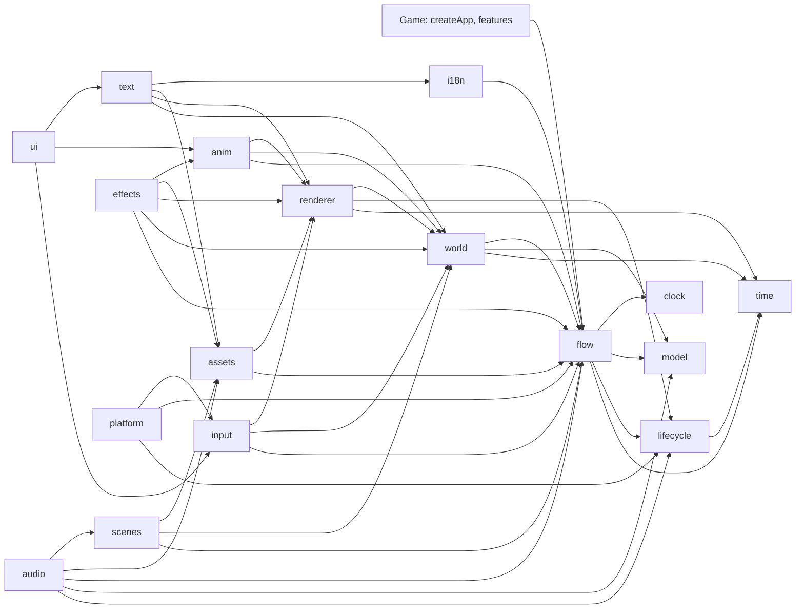

# @moku-labs/game — Plugin & Property Index

**Synced version:** `0.15.92` (catalog from the `v0.14.9` tag, and 0.14.10 to 0.15.92 from the diff between
the tags and the bodies of the PRs: `llms.txt`, `docs/plugins.md`, `docs/events.md`,
`docs/configuration.md`, `docs/doors.md`, `docs/shell.md`, `docs/lint.md`, `docs/testing.md`,
`docs/hot-swap.md`, `docs/project-index.md`, `src/plugins/*/README.md`, and the export lists of
`src/index.ts`, `src/app.ts`, `src/cli.ts`, `src/testing.ts`, `src/visual.ts`, `src/project.ts`).
`@moku-labs/core ^1.7.1` and `@moku-labs/common ^0.3.4` are **peer** dependencies (Bun installs them on
`bun add`). `pixi.js ^8.22.0` is a **peer** dependency (`^8.0.0` before 0.14.13). Optional peers: `playwright-core` (the pixel leg of the
visual tests), `sharp` (the asset pack), `typescript >=5.5` (the project index), `@moku-labs/system ^0.3.1`
(the system shell, the store save), `@moku-labs/native ^0.3.13` (`moku-game native`). Engines node ≥24,
bun ≥1.4.2 (since 0.14.0; ≥1.3.14 before). ESM only. `"sideEffects"` lists the root entry
`./dist/index.mjs` only (since 0.13.2; `false` before).

The second half indexes **`@moku-labs/editor@0.10.20`** (peers `@moku-labs/game >=0.15.0` and
`typescript >=5.5`).

> The package ships `llms.txt` since 0.4.0 (`node_modules/@moku-labs/game/llms.txt`). It matches the
> installed version.

| Version | What changed for a game |
|---|---|
| 0.15.85 to 0.15.92 | Store builds: `native.signing`, `native.ios`, `moku-game native build <ios\|android> --store --build-number <n>` (0.15.85). The store-signed test app `native.dev` with `--store --dev`, and `native build ios --debug` (0.15.87). A door toggle takes `choices` and `choice` (0.15.87). A game's own number format: `defineTextFormats`, the feature key `textFormats`, `GameTypes.textFormats` (0.15.88). `pluginConfigs.renderer.shots` and `app.renderer.shots.take(key)`, `has(key)`: a small soft picture of the frame just drawn, for a loader (0.15.90). A line also breaks after a hyphen and at a soft hyphen (0.15.91). 0.15.92 is a test only |
| 0.15.57 to 0.15.84 | The leave loader `leave.loader.projection` is kept built and hidden, and is fed the switch with its load progress as `SceneSwitch`; `enter.cover` of the scene being entered sets the veil's colour and alpha (0.15.57). `page.boot` of `config.ts` shows a picture before the canvas and fades it into the first scene (0.15.58). `sync.debug.kept()` without a boolean switches nothing and warns `renderer:debug-kept-needs-boolean` (0.15.68). `leave.loader.holdMs` is a floor on the swap (0.15.82). Filter and kept-picture work in the renderer changes no API |
| 0.15.56 | **Behaviour: a guide owns Back.** While a guide narrows the open gate, Back is offered as `back` and counts as taken: `provider.exit()` is not called, and Escape is not pressed. A press the narrow refuses answers `blocked`, also inside the window. A fast walk that ends on a guided node shows the guide |
| 0.15.52 | **Behaviour: changes awaited guides in every game.** `defineNode({ guide: state => GuideOptions \| undefined })` derives the guide on a rest node. New `target`, `pad`, `veil`, `blocked`; `hand`, `text`, `highlight` are deprecated, the engine never drew them. **A guide now locks input outside its window**, through `app.input.lock.window(rect \| null \| undefined)`. A guide with no target, or a target that never shows, locks every press and soft-locks the step. Give every guide a shown `target`, or a `blocked: { intent }` the node accepts. The dev warning is `ui:guide-target-missing` |
| 0.15.54 | `lineHeight` on a text style. An `<anchor>` on a point. An image of no size draws nothing |
| 0.15.48 | `<anchor to={target} pad={n}>` sits on another element's drawn rect; `app.ui.rectOf(target)` answers that rect. Types `AnchorTarget` |
| 0.15.47 | Warm windows: `projection({ warm: (player, session) => item })` keeps one item built and hidden, so the window opens in the frame after the tap |
| 0.15.46 | **Look of every game: the scene veil fades in over 50 ms** (`scenes.leave.cover.inMs`, was 150). `schedule` resumes its node at once |
| 0.15.43 | The stage `flow.onEnter("begin", cb)`, before `"load"`. The veil goes up there, before the downloads |
| 0.15.41 | `slot("name", { shop: type<{ tab: string }>() })` declares named outcomes; a contribution that exits one leaves the slot at once. `contribution(slot, { flow, order, when? })` checks it at compile time |
| 0.15.38 to 0.15.40 | **Look of every game: a live scene switch dims the scene it leaves** (`scenes.leave`, default black 0.45) and shows a loader past 400 ms. Turn it off with `defineScene(id, { leave: false })` or `scenes.leave`. The scene is built in parts and applied in parts |
| 0.15.37 | `projection({ initialOnly: [[Shape, ["sweep"]]] })`: a view field another writer keeps |
| 0.15.31 | `tween` takes `segments` and `repeat` in a timeline; `repeat: "forever"` tracks |
| 0.15.29 | **Behaviour: a live scene switch builds the next scene aside and swaps it in one frame**, in the budget `scenes.buildMs` (`"auto"`). Until the swap `scenes.current()` answers the old scene and the new one is not drawn, hit or found by `ui.find`. `scenes:changed` is emitted at the swap. A fast walk and a headless app mount in one block as before |
| 0.15.27 | Named sfx: `sfx(key, { id, fadeMs })`, `fx.start(stopSfx(id, { fadeMs }))`, `app.audio.stop(id)`, config `audio.sfxFadeMs`. `blend: "add" \| "screen"` on `Sprite`, `NineSlice` and `style.blend` |
| 0.15.26 | A live switch warms the bundles the scene names before it mounts |
| 0.15.22 | The effect `ready(bundles)` lets a node rest on a load and stay answerable. `assets.warm(bundle)` and the upload budget `renderer.uploads` |
| 0.15.16 | `wrap: "box"` on a text style wraps at the laid-out width |
| 0.15.11 | `Overlay({ hold: true })` holds the endless loops under a sheet |
| 0.15.9 | `kind: "arc"` on `Shape`, `shape: "arc"` with `sweep`, `cap` in a style |
| 0.15.8 | Horizontal scroll: `<scroll axis="x">`, fling, `snap`, `offset`, `ScrollState`, `app.ui.scroll(key, to)`, door `game.scroll`. Fixed at spawn; the windowed form stays on `y` |
| 0.15.7 | `renderer.adaptiveScale`, backdrop filters |
| 0.15.4 | **Breaking: `systemsRun`, `ecs.hold`, `ecs.isActive` are gone.** A system with a `query` does not run while a term of its query has no entity. Work a system did outside its rows (a cleanup, a budget, a press that ends) moves to a system with `query: []`, or resets on `ctx.resumed`. `system({ scenes: ["board"] })` limits a system to mounted or leaving scenes. Distance-field text is batched |
| 0.15.0 | The version number only. The break came in with 0.14.13 and 0.15.4 |
| 0.14.13 | **Peer `pixi.js ^8.22.0`. Reserved names `debug`, `OverlayLevel` and the resource `Now`.** Nested features (`defineFeature(name, { features })`, `flattenFeatures`, the lint rule `moku-game/sub-features`, keys named by the sub-feature). `defineBundles` options `release: "leave"`, `mipmaps`. `defineScene(id, { bundles: state => [...] })`. `app.assets.has`, `companions`. Render on demand (`renderer.onDemand`, `app.renderer.invalidate(entity)`). Kept pictures (`renderer.keptMb`, `cache` on a filter, `canvasPixel(uv)`). `Overlay`, `HudPart`, layers `{ above: "overlays" }`. Adaptive frame rate (`time.adaptive`, `time.rate()`, `setRate`, events `time:rate`, `time:thermal`). Debug builds: `moku-game build --debug`, `native build android --debug`, `app.debug.overlay`, `DebugTrigger`, the agent telemetry `app.renderer.monitor`. Typed effects: `defineEffect`, `Flow.Answer`; **`NodeFx` is generic, so a hand-made `vi.fn` fx spy no longer fits: use `fakeFx`.** Behaviour: a finger that has not started a gesture gives way to the next finger, `Pointer.id` is added; **the `ui` layer sorts by `Order`**, a JSX child's `Order` is composite; enter and exit hooks get a `MotionCause`; `ecs.snapshot()` returns copies; a test that `toEqual`s `stats()` or `snapshot().resources` adds the new fields; a text baseline may differ about 0.3 % at glyph edges |
| 0.14.12 | A JSX description that says what the last one said costs the comparison only: no style pass, no layout, no write. `ui` compares prop by prop, by value, so an inline `style` object is fine. A style object changed in place is not seen: build a new one. A function, a `Set`, a `Map` and a class instance compare by identity. `UiCounters` adds `styled` and `written`. A `cosmetic` effect (`sfx`, `play`, `haptic`, `music`) that fails writes the warn entry `flow:fx-cosmetic-failed` with `{ kind, message }`; it still resolves `undefined`. `fakeFx` and the types `FakeFx`, `FakeFxOptions` in `@moku-labs/game/testing` |
| 0.14.11 | A node of `ui.tree()` and of the door `game.ui` carries `textStyle`: the text style key of a `text` whose `style` prop is a key. `describe.json` of a visual test leaves it out, so baselines stay |
| 0.14.10 | **Behaviour: `game.headless()` composes `logicOnly` of `features` when `headless.features` is left out** (nothing before). `headless: { features: [] }` composes none; `shared` and `plugins` are never taken by default. `fx.start(descriptor)` in a node and in `recover`: starts an effect and does not wait; refuses `answers` and a `guide`; a failure is the error entry `flow:fx-start-failed` with `{ path, kind }`. A rollback settles every view of a mounted projection the failed node moved off its rest pose; ui elements are not settled. The `loop` of a view that entered on a mount, a load or a restore starts on the next live frame. A projection may build a new item object on every commit: a view whose components did not change keeps its motions. `TweenDriver.offsetsOf(entity, component)`, optional, for a custom tween driver |
| 0.14.4 to 0.14.9 | Nothing a game meets. 0.14.5 fixes a type check inside `scenes`; the rest is CI, tests and dev dependencies |
| 0.14.3 | After a restore or a load the picture is the one of the restored state: every view stands on its rest pose with no motion running, and every ui root is built again through the mount path, so `enter` hooks run again. Local state, scroll offsets, hover and focus start anew. The entity of an element is another one: ask `ui.find(key)` again. `world.projection.onConverged(listener)` |
| 0.14.2 | Flow config `holdMs`: how long an answer a closed gate refused is kept for the next gate. Every node failure is an `error` entry `flow:error` in the log. `recover` on the safe node. The audio context is asked to run at start, so `audio.unlocked()` can be true with no touch |
| 0.14.1 | CI only |
| 0.14.0 | **Engines: Bun ≥1.4.2.** `game.restore` of a popup bookmark mounts the bookmark's scene also on a page that shows another scene. `flow.restore` also resolves when the loop ends first |
| 0.13.3 | A bookmark taken while a popup waits for its answer names the waiting transit node and carries `rest: { path, input }`. A restore of it runs that node again and resolves once its gate is open |
| 0.13.2 | Under `moku-game dev` an asset file saved with new bytes swaps in the running game; a new, removed or renamed one reloads the page. The dev event `assets:replaced`. `"sideEffects"` lists the root entry only, so a hot swap of a module that imports `@moku-labs/game` no longer reloads the page |
| 0.13.1 | `moku-game dev` runs the scan of `keys` at start and on a save of an asset or a strings file, so `generated/` stays fresh. `watchKeys` in `@moku-labs/game/cli` for the editor. `dev` writes `.moku/assets-stamp.ts`, and every file answers `Cache-Control: no-store` |
| 0.13.0 | `moku-game keys` writes the dev manifest to `generated/manifest.json`, not `<root>/manifest.json`. `dev` serves it on `/manifest.json`, so the page still fetches `manifest.json` next to itself. The project index reads it by default. The build output is unchanged: `dist/assets/manifest.json`. `moku-game-assets` keeps its own `--manifest` default |
| 0.12.0 | `moku-game visual` runs `tests/visual/index.ts` against `tests/visual/baselines/`. `test-suffix` passes the `index.ts` of a test kind folder. A texture in an `fx/` folder packs into the `fx` atlas group. Root exports `messageArgument`, `messageDuration` (a generated strings module imports them). `parseVisualArgv` reads `--pixels` |
| 0.11.0 | `PlatformApi.exit()`. The page bundles only the system plugins `config.ts` names |
| 0.10.0 | The game shell: `defineGameApp`, `config.ts` (`GameConfig`), the bin `moku-game`, `startPage`, `preparePage` |
| 0.9.0 | The layered layout: `--layer`, `layer-imports`, `feature-door`, `test-suffix`, hot swap of the kind folders. The `AnimPlayer` resource; `resource(name, () => value)` |
| 0.8.0 | The entry `./visual`; `./testing` has no `node:` import. `audioPlugin`, `effectsPlugin`, `platformPlugin` are named in the root entry. The merge game left the engine for moku-labs/demos |
| 0.7.x | `static-keys`; `{prop}` holes in JSX keys; `component:<Name>` and style-factory keys in the project index |
| 0.6.0 | The entry `./project` and the bin `moku-game-index` |
| 0.5.0 | The entry `./hot`; `replace` on `world.projection`, `anim`, `i18n`; `text.replaceStyles`; `scenes.expect`; the bookmark `scene`; the global event `ui:hot-swap` |

The rows 0.5.0 to 0.9.0 are read from the source of each tag and the commit subjects between the tags.

**Breaking in 0.4.0** (pre-1.0): a literal `{ component, field }` text bind became `bind(Component, "field")`;
`game.capture` answers `{ png }`, not a string; `game.rect` became `game.locate`; `assets.audio(key)` answers
`{ bytes, mime }`; `runCli(argv, strings)` takes `{ compile, exportStrings, importStrings }`.

## Plugin sets

```ts
// what game.screen() of defineGameApp composes; a game writes no createApp
createApp({ plugins: [...screen, audioPlugin, effectsPlugin, platformPlugin, shared, ...features, ...gamePlugins] });
```

| Set | Plugins | How |
|---|---|---|
| logic | `time`, `lifecycle`, `model`, `clock`, `flow`, and `debug` (since 0.14.13: the name is reserved, a game never lists it) | always registered |
| screen | `world`, `renderer`, `input`, `assets`, `scenes`, `anim`, `i18n`, `text`, `ui` | the exported list `screen` |
| opt-in | `effects`, `audio`, `platform` | append; `platform` last |

`log` and `env` from `@moku-labs/common` sit on every context as `ctx.log` and `ctx.env`. A feature name
is refused when it equals any plugin name above, or `log` / `env`.

## The 18 plugins

| Plugin | Tier | Depends on | Owns | App API (`app.<name>`) |
|---|---|---|---|---|
| `time` | Standard | — | One `requestAnimationFrame` loop, six phases `input, animate, layout, sync, signals, render`, the `Time` resource `{ delta, elapsed, scale, frame, idle }`. Idle cap after `idleAfterMs` | `onFrame(phase, cb): () => void`, `snapshot()`, `setScale(scale)`, `pause()`, `resume()`, `isPaused()`, `isRunning()`, `step(deltaMs)`, `wake()`, `rate()`, `setRate("auto" \| 30 \| 60 \| 120)` (since 0.14.13) |
| `debug` | Micro | — | The editor's overlay from the game, in every app. Nothing in a release build | `overlay.open({ mode?: "pill" \| "card" })`, `close()`, `toggle()`, `isOpen()`: each answers `false` without the agent flag |
| `lifecycle` | Standard | time | The stack of pause reasons: `"background"`, `"devtools"`, `"system-dialog"`, `"device-lost"`, any string | `push(reason)`, `pop(reason)`, `reasons()`, `isPaused()` |
| `model` | Very Complex | — | The `session` tree and the save document `{ player, rng }`; transactions, rest-point rollback, rng streams, migrations | `store.load()`, `store.snapshot()` (frozen `{ player, session, rng }`), `store.begin()`, `store.markRest()`, `store.markBarrier(txId)`, `store.rollback()`, `store.restore(input)`, `store.flush()`, `rng.peek(id)` |
| `clock` | Standard | — | Trusted time: monotonic `now()`, one `elapsed` signal at the next due moment | `now()`, `scheduleAt(moment \| undefined)`, `onElapsed(listener)`, `poke()`, `dueAt()` |
| `flow` | Very Complex | time, lifecycle, model, clock | The graph: runner, gate, inbox, effects gateway, features registry | `run()`, `onEnter("begin" \| "load" \| "scene", cb)` (`"begin"` since 0.15.43, must not wait), `walk(route, { from? })`, `bookmark()` (the last rest node, or the transit node that waits for a popup's answer, then with `rest`), `restore(bookmark)`, `describe()`, `state()`, `history()`, `setMode("live" \| "fast")` (throws while a transit node waits at the gate); `gate.answer({ intent, payload? }): boolean` (`false` at a closed gate: the answer is held for the next gate, see `holdMs`), `gate.pointer(active)`, `gate.state()` (`{ open, allowed, narrowed, blocked? }`); `inbox.post({ type, payload? })`; `fx.handle(kind, handler, { runInFast? })`, `fx.dispatch(descriptor)` (the `fx` of a node context is another thing: `await fx(descriptor)`, `fx.start(descriptor)` since 0.14.10, `fx.emit(hint)`); `features.register(name, description)`, `features.all()`, `features.contributions(slot)` |
| `world` | Very Complex | time, model, flow | A zero-dependency ECS and the projection from committed state to entities: keyed reconcile of one `view(item)`, retarget motions, despawn queue, named layers | `ecs.spawn(owner, components)`, `ecs.query(...C)`, `ecs.system(def)`, `ecs.set(entity, C, patch)`, `ecs.changed(C)`, `ecs.snapshot()`, `ecs.mode()`; `projection.mount(names, owner)`, `projection.replace(spec)` (dev hot swap), `projection.setLayers(list)`, `projection.settle(entity)`, `projection.keyOf(entity)`, `projection.entityOf(projection, key)`, `projection.onConverged(listener)` (since 0.14.3: after the reconcile of a restore or a load), `projection.causeOf(entity)`, `projection.feed(name, sw)`. `ecs.hold` and `ecs.isActive` are gone since 0.15.4. A view takes `initialOnly` and `warm` on `projection()` |
| `renderer` | Very Complex | time, lifecycle, world | Pixi v8 host loaded lazily, one `sync` system that owns every display object, the reference viewport, frame stats | `host.ready()`, `host.kind()`, `host.canvas()`, `host.pixi()`, `host.device()`, `host.gl()`; `sync.hitTest(x, y, accept)`, `sync.hitAll(x, y)`, `sync.boundsOf(entity)`, `sync.hitBoxOf(entity)`, `sync.textures.provide(fn)`, `sync.fonts.install(key, fnt, texture)`, `sync.filters.set(entity, slots)`, `sync.displayOf(entity)`, `sync.debug.nineSlice(on)`; `viewport.toReference(x, y)`, `viewport.toScreen({ x, y })`, `viewport.size()`; `stats()`, `capture(options?)` (dev only, `{ png, legend? }`; options `legend`, `layers`, `sheet`, `against`); since 0.14.13 `invalidate(entity)`, `sync.debug.kept(on)` (needs a boolean), `sync.debug.overdraw(on)`, `sync.debug.why()`, `monitor` (agent builds; `monitor.setResolution(n)` in every build); `shots.take(key)`, `shots.has(key)` (0.15.90) |
| `input` | Standard | flow, world, renderer | Gestures as data components `Tappable`, `Pressable`, `Draggable` (`{ payload, carry }`: `carry` lists keys of the same projection that ride along, a solitaire stack), `DropTarget`, `Swipeable`, `Traceable` (a word-game path of cells), `Touchable`, `Held`, `Hovered`, `PointerOver`, `Pressed`, `Traced` (on every cell of the trace in progress), `Pointer`; the intent reaches `flow.gate`. A trace answers once on release: `{ intent, payload: { path: [payload, …] } }` | `tap(target)`, `press(target)`, `drag(from, to)`, `swipe(target, direction)`, `trace(path)`, `pressKey(key, { shift })`, `lock.window(rect \| null \| undefined)` (0.15.52: what a guide sets; the doors are never locked) |
| `assets` | Complex | flow, renderer | Manifest, five tiers, graph-driven preload, texture budget with LRU unload, typed keys from the `./assets` door | `load(bundle)`, `warm(bundle)` (0.15.22), `unload(bundle)`, `isLoaded(bundle)`, `has(bundle)`, `companions.add(...)`, `texture(key)`, `font(key)`, `audio(key)` (`{ bytes, mime }` since 0.4.0), `usage()` |
| `scenes` | Standard | flow, world, assets | A scene as a declaration: bundle, `bundles` (from state), layers, projections, `music`, `leave`, `enter`. A node names its scene; the switch runs in `flow.onEnter("scene")`, builds the next scene aside and swaps it in one frame (0.15.29) | `current()`, `expect(id)` (the scene the next node without its own `scene` mounts: a rest node, or a transit node in live mode; an `over` node takes it also over another mounted scene; the restore door calls it; an unknown id throws) |
| `anim` | Complex | flow, world, renderer | The one tween core, timelines as frozen data from typed slots, `defineMotion` for enter/exit/change, the `Frames` component, the `AnimPlayer` resource a system plays through: `res(AnimPlayer).play(animation, slots)` | `play(animation, slots)`, `finishAll()`, `active()`, `onMark(fn)`, `replace(definition)` (dev hot swap), `setReducedMotion(on)`, `reducedMotion()` |
| `i18n` | Complex | flow | Strings as data: `tr(key, params)` is a `Message`; ICU MessageFormat compiled by `compileStrings`; `Part[]` at run time | `locale()`, `setLocale(locale)` (async), `format(message, locale?)`, `plain(message)`, `has(key)`, `duration(ms, style?)`, `locales()`, `replace(locale, messages)` (dev hot swap of a generated strings file). ICU `{x, duration, short}`; a string may be `{ "text", "note" }` for translators; pseudo-locale `en-XA` |
| `text` | Complex | time, flow, world, renderer, assets, i18n | The `Text` component, `label()`, `defineTextStyles()`, tags `<b> <i> <color=#hex> <icon=key>`, measurement from the font's advance table, BitmapText from MSDF fonts; `bind(Component, "field", { format? })` shows a numeric component field (`int`, `mm:ss`, `h:mm:ss`, `duration`, or a key of `defineTextFormats`, 0.15.88); a style takes `wrap: "box"` (0.15.16) and `lineHeight` (0.15.54); `Countdown({ until })` counts down to a `clock` moment | `measure(content, style)`, `hasGlyph(char, style)`, `styles()`, `replaceStyles(styles)` (dev hot swap) |
| `ui` | Very Complex | input, anim, text | A screen is a projection whose `view` returns JSX; reconciled by identity into entities, one Yoga solve per change; `defineComponent` with `local` and `outcomes`, `popup` as an effect, `defineStyle`, `defineTokens`; the `input` tag is a text field; `anchor` sits on another element's drawn rect (0.15.48); `scroll` has `axis`, `snap`, `offset` (0.15.8) and a windowed form on `y`: `rows`, `rowHeight`, `overscan` (5), `row`; draws a guide's veil (0.15.52); plays `change` hooks of any component in `motion`; emits the dev global event `ui:hot-swap` | `tree()` (a text node carries `content`, the words it draws after `tr()` and `bind`, and since 0.14.11 `textStyle` when its `style` is a text style key; a text field carries `value`), `find(key)`, `lint()`, `fill(key, value)`, `scroll(key, to)` (0.15.8), `rectOf(target)` (0.15.48: `{ x, y, w, h }` in screen reference units, `undefined` when none is shown) |
| `audio` | Standard | lifecycle, model, flow, assets, scenes | Opt-in. Buses `master`, `music`, `sfx`; `sfx()` and `music()` descriptors; the scene's `music`; volumes from the committed player; music `"decode"` (gapless buffer) or `"stream"` (`<audio>` element, about 12 MB instead of 58 MB); the iOS audio session (`"ambient"` by default) | `setVolume(bus, value)`, `volume(bus)`, `mute(bus, on)`, `muted(bus)` (since 0.4.4), `stop(id, { fadeMs? })` (0.15.27), `unlocked()` (since 0.14.2 true at start where the shell asks for no gesture; a browser tab unlocks on the first `pointerdown` or `touchend`), `journal()` |
| `effects` | Complex | flow, world, renderer, assets, anim | Opt-in. Particles (`defineEmitter`, `Emitter`); filters (`defineFilter` with WGSL + GLSL twin; built-in `Glow`, `Outline`, `Blur`, `ColorMatrix`, `Noise`, `Displacement`, `Alpha`). Headless draws nothing | `stats()`, `diagnostics.kinds()`, `disable(kind)`, `enable(kind)`, `disabled()` (a dev or agent page only) |
| `platform` | Standard | lifecycle, flow, input | The phone as a `PlatformProvider`: pause/resume → `"background"`, Back chain (a guide takes it first since 0.15.56; then Escape, then intent `back`, then `exit()`), `haptic` effect, `keepAwake`. Inert without a provider. The shell fills the provider from `config.ts` `system` | `back()`, `exit()` (since 0.11: leaves through the provider; a throw is logged; nothing without a provider) |

### Dependency graph



## Root exports

| Export | Kind | Purpose |
|---|---|---|
| `createApp`, `createPlugin` | functions | The game app; a game plugin bound to the engine's config and events |
| `defineGame<Types>()` | function | Returns the typed kit: `defineNode`, `defineFlow`, `defineFeature`, `projection`, `sprite`, `Sprite`, `NineSlice`, `defineBundles`, `load`, `defineScene`, `tr`, `label`, `bind`, `defineTextStyles`, `defineTextFormats`, `defineComponent`, `defineStyle`, `defineTokens`, `popup`, `defineAnimation`, `frames`, `sfx`, `play`, `music`, `Frames`, `defineEmitter`, `Emitter`, `Displacement`, `system` (typed `ctx.snapshot`), `volumes`, `key`. `Types = { player; session; assets: string; bundles?: string; scenes?: string; strings: Record<string, unknown>; textStyles?: string; textFormats?: string; emitters?: string }`, and `hud` for `HudPart` keys |
| `defineFeature` | function | Untyped twin of the kit's. Keys: `nodes`, `flows`, `contribute`, `projections`, `systems`, `components`, `scenes`, `assets`, `animations`, `ui`, `strings`, `textStyles`, `textFormats`, `emitters`, `filters`, `features` (sub-features). `systemsRun` is refused since 0.15.4 |
| `flattenFeatures` | function | The flat plugin list of a feature tree, a parent before its children. `defineGameApp` calls it; a `createApp` by hand calls it |
| `type`, `exit`, `to`, `slot`, `contribution` | functions | Payload type tag; the three edge helpers; `slot(name, outcomes?)` declares named outcomes since 0.15.41; `contribution(slot, { flow, order, when? })` builds a `contribute` entry and checks it at compile time |
| `schedule`, `guide`, `hint`, `defineEffect` | functions | Effect descriptors: next due moment, tutorial narrowing of the gate, cosmetic hint. `defineEffect<Input, Result>(kind, { fast: "run" })` declares a game's own typed effect |
| `SaveUnreadableError` | class | From `model.store.load()`: `savedVersion`, `schemaVersion` |
| `component`, `tag`, `resource`, `mut`, `system`, `projection`, `Layer`, `Order`, `Exiting`, `Tree`, `Now` | ECS vocabulary | From `world`. `res(Now).now` is the frame's moment (reserved names: `Now`, `Pointer`, `AnimPlayer`, `UiCounters`). `resource(name, defaults)` clones plain defaults into every world; `resource(name, () => value)` calls the factory once per world, so the value may hold a `Map` or a function |
| `Transform`, `Sprite`, `NineSlice`, `Shape`, `Parent`, `Display`, `Overlay`, `HudPart`, `sprite` | components | From `renderer`. `Overlay({ dim, dimColor, cover, hud, fade, hold })` on an overlay's root keeps what is under it as one picture |
| `Tappable`, `Pressable`, `Draggable`, `DropTarget`, `Swipeable`, `Traceable`, `Touchable`, `Held`, `Hovered`, `PointerOver`, `Pressed`, `Pointer`, `Traced` | components | From `input` |
| `defineBundles`, `load`, `ready`, `defineScene` | functions | Bundles and scenes. `await fx(ready(bundles))` answers `false` and posts `{ type: "ready" }` once they settled, so a node rests on a load and stays answerable |
| `defineAnimation`, `sequence`, `parallel`, `stagger`, `tween`, `set`, `wait`, `mark`, `frames`, `sfx`, `haptic`, `use`, `spawn`, `spawned`, `play`, `external`, `defineMotion`, `Animation`, `Frames`, `AnimPlayer`, `cubicBezier`, `stopSfx` | anim | Choreography as frozen data; `play(animation, slots)` is the effect a node awaits; `spawn` makes a temporary entity the timeline despawns. A system cannot `require` a plugin, so it plays through the resource: `res(AnimPlayer).play(animation, slots)`. Before `anim` starts it throws `[game] AnimPlayer is not ready: anim has not started.` |
| `tr` | function | `tr(key, params?)` → frozen `Message` |
| `messageArgument`, `messageDuration` | functions | What a generated `strings.<locale>.ts` imports since 0.12: `messageArgument(value, intl)` formats one argument, `messageDuration(ms)` splits a duration (`95_000` gives `{ minutes: 1, seconds: 35 }`). A game never calls them |
| `Text`, `label`, `defineTextStyles`, `defineTextFormats`, `bind`, `Countdown`; types `BindOptions`, `CountdownValue`, `TextFormat`, `TextFormats`, `TextFormatAnswer`, `TextFormatFunction`, `FormattedNumber` | text | Words on screen; `bind` and `Countdown` show numbers and timers |
| `defineComponent`, `popup`, `defineStyle`, `defineTokens`, `resolve`, `Box`, `LocalWrite`, `DebugTrigger`, `ScrollState` | ui | Components, the popup effect, the style vocabulary |
| `music` | function | `music(key \| null, { fadeMs? })` |
| `defineEmitter`, `Emitter`, `defineFilter`, `Glow`, `Outline`, `Blur`, `ColorMatrix`, `Noise`, `Displacement`, `Alpha` | effects | Particles and filters as data |
| `PlatformProvider`, `BackResult`, `HapticKind`, `HAPTIC_KINDS` | types, constant | The seam a game fills for `platform` |
| `timePlugin` … `platformPlugin`, `screen` | plugin instances | For `depends` and `ctx.require`. All 18 are named exports: `debugPlugin`, `timePlugin`, `lifecyclePlugin`, `modelPlugin`, `clockPlugin`, `flowPlugin`, `worldPlugin`, `rendererPlugin`, `inputPlugin`, `assetsPlugin`, `scenesPlugin`, `animPlugin`, `i18nPlugin`, `textPlugin`, `uiPlugin`, `audioPlugin`, `effectsPlugin`, `platformPlugin` |
| `Time`, `Lifecycle`, `Model`, `Clock`, `Flow`, `World`, `Renderer`, `Input`, `Assets`, `Scenes`, `Anim`, `I18n`, `TextTypes`, `Ui`, `Audio`, `Effects`, `Platform` | type namespaces | `import type { Flow } from "@moku-labs/game"` then `Flow.RouteStep`, `Flow.NodeContext`, `Model.Json`, `Model.PlayerStateProvider`, `Clock.ClockSource`, `Anim.Target`. `Text` is the component, so its types are `TextTypes` |

## Game shell

| Entry | Runs in | Exports |
|---|---|---|
| `@moku-labs/game/app` | anywhere | `defineGameApp`, `startMoment` (`1_000_000`), types `GameConfig`, `GameDefinition`, `GameApp`, `GameHandle`, `GamePluginConfigs`, `HeadlessSeams`, `ScreenSeams`, `MemoryProvider`, `Scenario`, `PageAgent`, `SaveKind`, `SystemName`. No `node:` import, no system or native package |
| `@moku-labs/game/app/page` | browser | `startPage(game, config, { scenarios?, system?, agents?, devModules? })`: the page `moku-game` writes calls it |
| `@moku-labs/game/app/system` | browser, native shell | `systemShellOf`, `fromSystem`, `storeSave`, `createSystemApp`, types `SystemApp`, `SystemSlice`, `StoreSlice`, `SystemModules` |
| `@moku-labs/game/cli` | node, bun | `runCli`, `preparePage(root, { agents?, preload?, servePlugins? })` → `{ html, bunfig, engine }` (the editor calls it), `watchKeys(root, { onError? })` → `{ close() }` (since 0.13.1: the keys watch of `dev` for a server the caller runs; the editor calls it next to `preparePage`), `watchEngine(root, { onChange?, onError? })` (since 0.14.13: tells when the installed engine changed); types `PreparePageOptions`, `PreparedPage`, `WatchKeysOptions`, `KeysWatcher`, `WatchEngineOptions`, `EngineWatcher`, `EngineChange`, `EngineFingerprint` |
| bin `moku-game` | bun | `dev [--port 3000] [--packed]`, `build [--out dist/web] [--debug[=read\|full]] [--editor host:port]`, `native build|dev|doctor|clean [<target>] [--simulator] [--debug] [--store --build-number <n> [--dev]]`, `keys [--check]`, `pack [--no-cache]`, `visual [--update] [--only <name>] [--no-pixels \| --pixels] [--webgl] [--dir <path>] [--tests <file>] [--url <url>]`, `help`. Every command: `--root`, `--preload`, `--serve-plugin` |

| `moku-game` flag | Command | Default | What |
|---|---|---|---|
| `--root <dir>` | every | `.` | The game folder, against the cwd |
| `--preload <path>` | every | none | A file Bun preloads. Repeats |
| `--serve-plugin <path>` | `dev`, `build`, `native`, `visual` | none | A Bun plugin the page bundles with, after the hot plugin. Repeats |
| `--port <n>` | `dev` | `3000` | An integer 0-65535. `0` takes a free port |
| `--packed` | `dev` | off | Serves `dist/assets` instead of the raw files, and does not watch the keys |
| `--out <dir>` | `build` | `dist/web` | The output folder, replaced by the run. A folder that is the game, holds it, touches `dist/assets`, or lies in the game outside `dist/` is refused |
| `--debug[=read\|full]` | `build`, `native build` | off | A debug page, never shipped: the release page plus the editor's agent and the `.dev` modules. Needs `@moku-labs/editor` in the game. `native build android --debug` and `ios --debug` (0.15.87) install beside the store app. `=read` runs read and cosmetic commands only |
| `--editor <host:port>` | `build --debug`, `native build --debug` | `127.0.0.1:47600` | Where the debug page's agent dials |
| `--store` | `native build` | off | A store build for `ios` or `android` (0.15.85): an `.ipa` or an `.aab`. Needs `--build-number` and a signing block; every problem is one `[game] native --store: …` error before anything compiles. Refuses `--debug`, `--editor`, `--simulator` |
| `--build-number <n>` | `native build --store` | none | An integer from 1 to 2100000000 |
| `--dev` | `native build --store` | off | The store-signed test app of `native.dev` (0.15.87): `.moku/tauri-dev`, `dist-native-dev`. Needs `@moku-labs/editor` 0.10.19 or later |
| `--simulator` | `native build` | off | iOS: the simulator build |
| `--check` | `keys` | off | Fails when an output is out of date |
| `--no-cache` | `pack` | off | A cold pack |
| `--tests <file>` | `visual` | `tests/visual/index.ts` | The tests module, against the cwd |
| `--dir <path>` | `visual` | `tests/visual/baselines` | The baselines folder, against the cwd |
| `--update` | `visual` | off | Rewrites the baselines of every test it runs |
| `--only <name>` | `visual` | every test | Runs one test. Repeats |
| `--no-pixels`, `--pixels` | `visual` | pixels on a Mac only | The headless leg alone, or the pixel leg off a Mac too. The last one wins |
| `--webgl` | `visual` | off | The tests with `webgl: true`, on the page with `?renderer=webgl` |
| `--url <url>` | `visual` | the page served for the run | A page that is served already, such as `moku-game dev` |

The exit code is `0` on success, else `1` and a `[game] …` line. `visual` exits `1` when a checkpoint
differs or a test fails. What `moku-game` writes: `dev` writes `.moku/{index.html,script.ts,dev.ts,main.ts,bunfig.toml,assets-stamp.ts}` and prints `› engine <id>`, and restarts when the installed engine changes;
`visual` writes its own page into `.moku/visual/` when the pixel leg runs without `--url`, so it runs
while `dev` or the editor serves the game; `native` writes `.moku/tauri` and `dist-native`; `build`
writes nothing under `.moku/`.

**`dev` keeps `generated/` fresh** (since 0.13.1, on the raw files only):

- At start it runs the scan of `keys` before the page is written. A game needs no `moku-game keys`
  by hand before `dev`.
- A save of an asset file (`.png`, `.webp`, `.fnt`, `.mp3`, `.m4a`) or of a `strings/<locale>.json`
  scans again, 100 ms after the last file event, and prints `› keys: <path>` or `› keys: <path> and
  <n> more`.
- A failed scan is one warning, `[game] keys: <message>`. The server runs on.
- A changed layer in `config.ts` needs a restart. `--packed` watches nothing. `visual` does not
  watch: it still stops without `generated/manifest.json`.
- Every file the dev server answers carries `Cache-Control: no-store`.
- `keys` is for a run without the dev server, `keys --check` for CI.

| `defineGameApp` key | Default | What |
|---|---|---|
| `flow`, `player`, `session` | required | The main flow, the new player, the session at every start |
| `safeNode` | the start of the main flow | The checkpoint after a failed retry. Since 0.14.2 its `recover` runs first, when the node has one |
| `referenceLong`, `seed` | `1920`, `42` | Layout long side; the rng seed of a new save |
| `orientation`, `referenceSide` | `"portrait"`, `1080` | Since 0.14.13 |
| `strings` | none | `type<Strings>()`: types `app.i18n.isKey` |
| `shared`, `features`, `plugins` | none, `[]`, `[]` | The screen app composes them in this order, after the engine plugins. `features` lists the top level only: a parent brings its sub-features. A feature listed twice in the tree, or a `shared` with sub-features, throws |
| `headless` | `{}` | `{ features?, plugins? }`: what `game.headless()` composes (`logicOnly` of the features). Since 0.14.10 `features` left out takes the `features` of the game; `[]` means none. `shared` is not composed |
| `pluginConfigs` | `{}` | Every plugin config but the shell's keys: `model` `playerProvider`, `initialPlayer`, `initialSession`, `seed`; all of `clock`, `platform`; `flow` `mainFlow`, `safeNode`; `renderer.mount`; `assets` `manifest`, `io`; `audio.context` |

Seams of `game.headless(seams?)` and `game.screen(seams?)`: `seed`, `clock`, `provider`, `player`, `session`.
Screen only: `manifest` (a URL or the parsed file), `io`, `platform`, `keepAwake` (`false`),
`audio { context?, journal? }`, `renderer { mount?, loadPixi?, preference? }`. Both return
`{ app, clock, provider }`, the app not started.

`GameConfig` (`config.ts`): `page { title, lang?, background?, orientation?, icons?, head?, boot? }`,
`native? { name, identifier, icon?, targets?, signing?, ios?, dev? }`, `system?` (`lifecycle`, `back`, `haptics`, `keepAwake`,
`store`), `save?` (`"memory"`, `"local"`, `"store"`), `assets? { layers? }`, `debug? { overlay? }`.

- `page.boot` (0.15.58): `{ image, width?, fadeMs? }`. An `` over the canvas from the first paint until the first scene drew, then faded over `fadeMs` (`300`). `width` defaults to `"40vmin"`.
- `native.signing` (0.15.85): `android: { keystorePath, keystorePasswordEnv, keyPasswordEnv?, keyAlias }`, the passwords by env var name only; `apple: { teamId }`. An iOS store build signs with the Tauri env vars `APPLE_API_ISSUER`, `APPLE_API_KEY`, `APPLE_API_KEY_PATH`.
- `native.ios` (0.15.85): `{ minimumVersion?, infoPlist?, privacyManifest? }`, the minimum `"26.0"` by default.
- `native.dev` (0.15.87): `{ identifier, name?, icon? }`, the test app of `--store --dev`.
- `debug.overlay` (0.14.13): `"closed"`, `"pill"` or `"open"`, read only on a page with the agent.

## Other entries

| Entry | Runs in | Exports |
|---|---|---|
| `@moku-labs/game/testing` | anywhere (no `node:` import since 0.8) | `createHeadless`, `runRepro`, `stepFrames`, `fakeClock`, `memory`, `saveOf`, `isolate`, `stub`, `fakeFx` (since 0.14.12: `(options?: FakeFxOptions) => FakeFx`, the `fx` of a node context for a test that calls `node.run(context)` itself; it records `awaited`, `started` and `emitted`, `options.answer(descriptor)` answers an awaited effect, `options.path` names the node in a refused `fx.start`); types `HeadlessApp`, `HeadlessGame`, `Repro`, `ReproResult`, `IsolateOptions`, `IsolateSeams`, `Stub`, `StubsOf`, `FakeFx`, `FakeFxOptions` |
| `@moku-labs/game/visual` | node, bun | `defineVisualTest(name, { start, steps, webgl? })`, `runVisualTests(setup, tests, options?)`, `parseVisualArgv(argv)` (`--update`, `--no-pixels`, `--pixels`, `--webgl`, `--only <name>`, `--dir <path>`); types `VisualTest`, `VisualStart`, `VisualStep`, `VisualSetup` (`{ app, page? }`), `VisualApp`, `VisualPage`, `VisualOptions`, `VisualRenderer`, `VisualTolerance`, `VisualReport`, `VisualTestResult`, `CheckpointResult`. The bin runs them: `moku-game visual` |
| `@moku-labs/game/assets` | node, bun | `scanAssets`, `emitKeys`, `emitManifest`, `compileStrings`, `checkStrings`, `packAssets`, `exportStrings`, `importStrings`, `runCli(argv, { compile: compileStrings, exportStrings, importStrings })`. Flags: `--root <dir>` (default `.`), `--manifest <file>` (default `<root>/manifest.json`), `--keys <file>` (default `<root>/generated/assets.ts`), `--pack <dir>`, `--check`, `--no-cache`, `--pseudo` (en-XA), `--export <dir>`, `--import <dir>`, `--source <locale>` (default `en`). `--layer <folder>[=<name>]`. Audio `.mp3` or `.m4a`. Bin `moku-game-assets` (Bun shebang); a game with `config.ts` runs `moku-game keys` and `pack` instead |
| `@moku-labs/game/fonts/*` | files | `font-body.fnt`, `font-body.png` (Pangolin Regular MSDF, one 512×512 page), `LICENSE.txt` (SIL OFL 1.1). Copy into `shared/assets/` (scanned as the layer `ui`) for the key `ui.font-body` |
| `@moku-labs/game/inspect` | anywhere | `read`, `watch`, `defineSource`, `sources`, types `Source`, `InputSchema`, `InputOf` |
| `@moku-labs/game/control` | dev builds | `run`, `defineCommand`, `controlRefused`, `controlReadOnly`, `commands`, types `Command`, `ChoiceInput`, `ToggleInput`, `Ran`, `ControlReadOnlyError` |
| `@moku-labs/game/jsx-runtime`, `/jsx-dev-runtime` | anywhere | What `"jsxImportSource": "@moku-labs/game"` resolves to |
| `@moku-labs/game/lint` | oxlint 1.86.0+ (`jsPlugins`) | Default export: the plugin `moku-game` with eleven rules (`sub-features` since 0.14.13); `aliasTargetsOf`. See "Lint rules" below |
| `@moku-labs/game/hot` | the Bun dev server | Default export: the Bun plugin that hot swaps views; `hot({ include?, exclude? })` for another layout. `moku-game dev` lists it first in `.moku/bunfig.toml`; `moku-game build` never loads it. See "Hot swap" below |
| `@moku-labs/game/project` | node, bun | `openProject({ root, manifest?, tsconfig?, debounceMs? })` → `ProjectApi` (`index`, `find(key)`, `watch(onIndex)`, `changed(path)`, `close()`); types `Anchor`, `Found`, `IndexUi`, `JsxKind`, `ProjectApi`, `ProjectChange`, `ProjectIndex`, `ProjectOptions`. Needs the optional peer `typescript`. Bin `moku-game-index`. See "Project index" below |

### Lint rules (`@moku-labs/game/lint`)

```json
{
  "jsPlugins": ["@moku-labs/game/lint"],
  "rules": {
    "moku-game/lazy-imports": "error",
    "moku-game/native-imports": "error",
    "moku-game/dev-imports": "error",
    "moku-game/no-module-state": "error",
    "moku-game/determinism": "error",
    "moku-game/rules-siblings": "error",
    "moku-game/static-keys": "error",
    "moku-game/layer-imports": "error",
    "moku-game/feature-door": "error",
    "moku-game/sub-features": "error",
    "moku-game/test-suffix": "error"
  }
}
```

| Rule | Engine rule | Reports | Default `files` |
|---|---|---|---|
| `lazy-imports` | L2 | Static value import of `pixi.js`, `yoga-layout`. `import type`, `import()` pass. `import { type A }` is reported | `**` |
| `native-imports` | L13 | `@moku-labs/system`, `@moku-labs/native`, `@tauri-apps/*` | the logic, `config.ts`, `**/kit.ts`, `**/plugins/**` |
| `dev-imports` | dev only | `@moku-labs/editor`, `@moku-labs/game/control` | all but `.moku/**`, `*.dev.ts(x)`, tests |
| `no-module-state` | L5 | Module-scope `let`, `var`, `new Map/Set/WeakMap/WeakSet` | `**` |
| `determinism` | L3 | `Math.random`, `Date.now`, `performance.now`, `new Date()`, `setTimeout`, `setInterval`. `new Date(now)` passes. Plugin folders `**/{plugin,plugins}/**` are the effect side and are skipped | the logic |
| `rules-siblings` | L4 | An import that is not a sibling, `@core/types` or `@shared/rules` | `**/rules/**` |
| `static-keys` | keys | A JSX `key` the project index cannot follow | `**/*.tsx` |
| `layer-imports` | layers | An import above its own layer: core ← shared ← features ← `game.ts`; plugins import core and shared | `**`, not `generated/` |
| `feature-door` | doors | A deep import of another feature, a barrel below `game.ts`, a feature's own door, a relative import out of a feature. At any depth since 0.14.13: a sub-feature never imports a feature it lives in | `**/{core,shared,features,plugins}/**` |
| `sub-features` | doors | A parent's door that does not import and list every sub-feature folder, lists anything else, or a sub-feature's door that does not register a feature named like its folder. A flat game reports nothing | `**/features/**/index.{ts,tsx}` |
| `test-suffix` | tests | A file in a test kind folder without the folder's suffix: `tests/e2e/` `.e2e.ts`, `tests/visual/` `.visual.ts`, `tests/editor/` `.editor.ts`, `__tests__/`, `__tests__/unit/`, `__tests__/integration/` `.test.ts`, `__tests__/isolated/` `.isolated.ts`, `__tests__/visual/` `.visual.ts`; a `.tsx` file adds an `x`. Since 0.12 the folder's `index.ts` passes (`tests/visual/index.ts`). Helpers go to `tests/helpers/` or `__tests__/fixtures/` | `**/tests/**`, `**/__tests__/**` |

- The logic = the root `index.ts`, `**/state.ts`, `**/tables.ts`, `**/game.ts`,
  `**/{core,nodes,flows,rules,features,shared}/**`.
- Every rule but `test-suffix` skips `tests/**`, `**/__tests__/**`, `*.{test,spec}.{ts,tsx}`.
- The layout rules take `root` and `tsconfig` and read the tsconfig `paths`; without them the v15 aliases
  (`@core/*`, `@shared`, `@features/*`, …).
- Options per rule: `["error", { "files": [...], "ignores": [...] }]`. Globs are relative to the
  directory oxlint runs in. A key given replaces the default. `test-suffix` also takes `root` and
  `suffixes` (kind folder to suffix; it replaces the table whole).
- Layers under the game root: `core/**`, `shared/**`, `features/<f>/**`, `plugins/<p>/**`, `generated/**`,
  `game.ts`, `tests/**`. Every layer may import `generated/`. Only `game.ts` imports `game.ts`.
- Types: `GameLintOptions`, `GameLintLayoutOptions`, `GameLintSuffixOptions`, `GameLintPlugin`,
  `GameLintRuleName` from `@moku-labs/game/lint`.

## Visual tests (`@moku-labs/game/visual`, `moku-game visual`)

```ts
// tests/visual/index.ts: what `moku-game visual` reads
import game from "../../index";
import { home } from "./home.visual";

export default { app: { app: () => game.screen().app }, tests: [home] };
```

- The default export is the two arguments of `runVisualTests`: `app`, a `VisualSetup` `{ app, page? }`,
  and `tests`, the list of `defineVisualTest` results. A bare app factory is refused: `[game] visual:
  tests/visual/index.ts must export default { app, tests }.`
- A step is a `/control` command by its short name (`answer`, `tap`, `drag`, `key`, `fill`, `scroll`, `walk`,
  `restore`, `step`, `pause`, `resume`, `reducedMotion`) with that command's input, or `{ checkpoint: "name", finish?: boolean }`.
  A checkpoint lands every motion before its snapshot; `finish: false` (0.15.32) keeps them running. The pixel leg runs on the same fake clock as the headless one.
- A checkpoint writes `tests/visual/baselines/<test>/<checkpoint>/state.json`, `describe.json` and
  `screen.webp`. A missing file is written, `--update` rewrites, any other file is compared.
- The headless leg plays in plain Bun and compares `state.json` and `describe.json` exactly. The pixel
  leg plays the same steps in Chrome on a Mac and compares `screen.webp` (a pixel differs above 24 per
  channel, a checkpoint above 0.1 % of pixels). It needs the optional peer `playwright-core`. A pixel
  difference writes `screen.actual.webp` and `screen.diff.webp` beside the baseline.
- `--webgl` runs only the tests with `webgl: true` and writes `screen.webgl.webp`.
- Without `generated/manifest.json` a run that serves the page stops: `[game] visual: no generated/manifest.json in "<game>".`
  with `Run "moku-game keys" first.`
- An app made with `game.screen()` and no `{ manifest, io }` seam measures text at 0.6 em and warns
  `text: the font is not loaded`. A game that wants the page's layout in `describe.json` passes the
  parsed manifest and a file seam of its own; the engine's fixture does it in
  `tests/integration/mini-helpers.ts` (`folderIo`), which is not in the npm package.

## Hot swap (`@moku-labs/game/hot`, dev only)

`moku-game dev`, `moku-game visual` and the editor's engine page list the plugin first in the bunfig they
write, so a game sets nothing. `moku-game build` never loads it.

| A save of | Does |
|---|---|
| `.tsx`, `styles.ts`, `view.ts`, `animations.ts`, `effects.ts`, `generated/strings.<locale>.ts`; any `.ts` directly in `styles/`, `motion/`, `effects/`, `views/`, `world/projections/`, `world/layout/` of a feature or of `shared/` | Swaps the module in the running page: same state, same node, no reload. Logs `ui:hot-swap` and emits the global event |
| `rules/`, `nodes/`, `flows/`, `state.ts`, `tables.ts`, `kit.ts`, a feature `index.ts`, `world/components/`, `world/systems/` | Reloads the page; the editor restores the state |
| A view file that exports a scene, system, ECS component, filter, flow, node, feature, plugin, a new projection or a new animation | Refused: `ui` logs `ui:hot-refused` and throws, and Bun reloads the page |
| A string value or a new key in `strings/<locale>.json` (since 0.13.1, needs the keys watch) | Swaps: the watch writes `generated/strings.<locale>.ts`, a view module |
| An asset file saved with new bytes: a texture, a `.fnt` or its page, a sound (since 0.13.2, needs the keys watch) | Swaps in the loaded bundles, same key, no reload. `assets` emits `assets:replaced` |
| An asset file that is new, removed or renamed, also a changed nine-slice tag in the file name | Reloads the page; the editor restores the state |

- What swaps: styles, components, function components, projections of a registered name, animations,
  text styles, emitters, strings, asset bytes.
- The keys watch runs under `moku-game dev` on the raw files and under the editor (0.9.5 and later, through
  `watchKeys`). Only a game with a server of its own runs `bun run keys` after a strings JSON edit.
- The asset swap: the watch writes `.moku/assets-stamp.ts` (`{ files, changed }`), which `main.ts`
  imports. Not with `--packed`, not in a built game, not headless. A bundle that is not loaded reads the
  new bytes on its next load. A sound that is playing plays on with the old bytes. A running particle
  effect of a replaced texture starts again. A file that cannot be fetched or decoded logs
  `assets:replace-failed` and the bundle keeps the old asset. An image outside every `assets/` folder is ignored.
- A view module may import the root `@moku-labs/game` (since 0.13.2).
- Keep a view helper in the module of the projection that uses it. A function another module stored into
  an object at load time keeps the old version.
- A game with a server of its own lists the plugin in its own `bunfig.toml`: `[serve.static]` `plugins =
  ["@moku-labs/game/hot"]`. Another layout: `export default hot({ include, exclude })` from the game's
  `hot.ts`, listed as `plugins = ["./hot.ts"]`.

## Project index (`@moku-labs/game/project`, bin `moku-game-index`)

Maps every engine id of a game to anchors (a path plus a binding, a key or a component), never to line
numbers; `find` reads the line from the file on disk at the call. It follows the tsconfig `paths`.

| Key | Names |
|---|---|
| `flow:<id>`, `node:<flow>/<node>` | A flow; every entry of a `nodes` table (node, sub-flow, slot) |
| `feature:<id>`, `scene:<id>`, `projection:<name>`, `system:<name>`, `emitter:<id>`, `textStyle:<key>` | The definer call of that id. `index.features` holds every feature's folder and parent |
| `style:<path>#<binding>`, `style:<path>#<function>`, `style:<path>#<function>.<property>` | A `defineStyle` const, or the calls inside a module-level function |
| `component:<Name>` | An upper-case function in a `.tsx` file, or `defineComponent("Name", …)`; `uses` are the files that render it |
| `jsx:<key>` | A JSX `key`. A key-carrying prop (`id`, or a name that ends in `Key`) is a hole: `` key={`${props.id}Close`} `` reads `jsx:{id}Close` |

```sh
bunx moku-game-index --root . where node:main/home    # <path>:<line> per place; exit 1 for an unknown key
bunx moku-game-index --root . --check                 # exit 1 on a broken file or a key in conflict
bunx moku-game-index --root . --json                  # the whole index
```

- `--root` is required. `--manifest <path>` and `--tsconfig <path>` are root-relative. The manifest defaults to
  `generated/manifest.json` (since 0.13.0).
- A non-literal id goes to `index.unresolved` with the reason, never guessed. `moku-game/static-keys`
  keeps JSX keys followable.
- `typescript` (`>=5.5`) is an optional peer: without it `openProject` rejects with `[game] The project
  index needs the "typescript" package.` The index reads through the TypeScript JS API, which
  TypeScript 7 does not have.

## Asset pack groups

`moku-game pack` puts the textures of one bundle into atlas groups. `fx` holds the textures whose key's
last segment starts with `fx-` (`ui.fx-spark`), and since 0.12 everything in an `fx` folder (`ui.fx.leaf`
from `assets/fx/leaf.webp`, the frames `ui.fx.coin-spin.0` too), whatever the size: a particle emitter
binds one page. `main` holds every other texture with no side above 512 px. A stem named `fx` with no
folder (`ui.fx`) is not an fx folder.

## Events

One event is global: `ui:hot-swap`, so `effects` and `assets` hook it with no `depends` on `ui`. Every other event
belongs to a plugin. `clock`, `text`, `audio`, `effects`, `platform` emit nothing; `ui` emits only
the dev `ui:hot-swap`.

| Event | Emitted by | Payload | When |
|---|---|---|---|
| `time:rate` | `time` | `{ from, to, reason, mode, displayHz, thermal, window, dwellMs }` | The loop's frame rate or its mode changed. Never per frame, never at start |
| `time:thermal` | `time` | `{ status, headroom, at, android }` | The native shell's thermal reading, in an agent build or with `adaptive` |
| `lifecycle:changed` | `lifecycle` | `{ reason, action: "push" \| "pop", reasons, paused, resumed }` | The pause stack changed; `resumed` only on the change that emptied it |
| `model:committed` | `model` | `{ roots: ("player" \| "session" \| "rng")[], cause: "edge" \| "rollback" \| "restore" \| "load" }` | Committed state changed |
| `flow:edge` | `flow` | `{ flow, node, outcome, payload, next, patches: { doc, session }, index, now }` | After the commit of an edge. The recovery of the safe node is an edge too: `node` and `next` are the safe node, `outcome` is `"recover"` |
| `flow:rest` | `flow` | `{ path, checkpoint }` | The graph entered a rest node. Also once when `flow.restore` enters the node of a bookmark, for a transit node too: `path` is then no rest node and `checkpoint` is false |
| `flow:error` | `flow` | `{ path, error, rolledBackTo, retry }` | A node failed and the graph rolled back. Since 0.14.2 the engine also writes it into the log as an `error` entry `flow:error` with `{ path, rolledBackTo, retry, error: { message, stack } }`: read it with `app.log.trace()` or `game.log`. Two more log entries, not events: the error `flow:fx-start-failed` `{ path, kind }` for a failed `fx.start` (0.14.10), the warn `flow:fx-cosmetic-failed` `{ kind, message }` for a failed `cosmetic` effect, awaited or started (0.14.12) |
| `world:reconciled` | `world` | counts per reconcile | Dev only, behind `reconciledEvent` |
| `renderer:device-lost` | `renderer` | `{ kind, reason }` | GPU device or context lost; `lifecycle` pushed |
| `assets:bundle-loaded` | `assets` | `{ bundle, tier, mb, reason: "boot" \| "enter" \| "request" \| "preload" }` | A bundle entered memory |
| `assets:bundle-unloaded` | `assets` | `{ bundle, tier, mb, reason: "budget" \| "request" \| "leave", keys }` | A bundle left memory |
| `assets:bundle-progress` | `assets` | `{ bundle, loaded, total }` | For a loading bar; no engine plugin listens |
| `assets:replaced` | `assets` | `{ bundle, keys }` | Dev only, since 0.13.2: a hot swap replaced files of one loaded bundle. One event per bundle per swap. `keys` are the asset keys with new bytes; `texture(key)`, `font(key)`, `audio(key)` answer the new object. `text`, `effects` and `audio` hook it. A game plugin that built something from a key hooks it with `depends: [assetsPlugin]` |
| `scenes:changed` | `scenes` | `{ from, to, music }` | The scene switched on entering a node: at the swap, since 0.15.29 |
| `anim:mark` | `anim` | `{ animation, mark }` | A `mark` step was reached |
| `anim:finished` | `anim` | `{ animation }` | A timeline ended or was finished; never on cancel |
| `i18n:locale-changed` | `i18n` | `{ locale }` | The new locale's module is loaded, or `replace` swapped messages of the current locale or the fallback; never at start |
| `ui:hot-swap` | `ui`, global | `{ file: string; module: Readonly<Record<string, unknown>> }` | Dev only: a saved view module was swapped; `module` is its new exports. `effects` replaces its emitters. For `.moku/assets-stamp.ts` it is only forwarded: `assets` replaces the changed files |

```ts
import { createPlugin, flowPlugin } from "@moku-labs/game";

export const edgeLog = createPlugin("edgeLog", {
  depends: [flowPlugin],
  hooks: ctx => ({
    "flow:edge": payload => {
      ctx.log.info("edge", { node: payload.node, outcome: payload.outcome });
    }
  })
});
```

A hook that throws never stops the game: the engine logs `"game: a hook failed"` through `onError`. A
plugin that owns a resource frees it in `onStop: ({ global, config, state }) => …`.

## Configuration

### Global

```ts
createApp({ config: { orientation: "portrait", referenceSide: 1080, referenceLong: 1920 } });
```

| Key | Type | Default | Meaning |
|---|---|---|---|
| `orientation` | `"portrait" \| "landscape"` | `"portrait"` | Orientation the game is designed for |
| `referenceSide` | `number` | `1080` | Short side of the reference resolution |
| `referenceLong` | `number` | `1920` | Long side the layout needs inside the safe area; scale is `min(short / referenceSide, safeLong / referenceLong)` |

### Per plugin (`pluginConfigs.<plugin>`)

A game sets them in `index.ts`: `defineGameApp({ pluginConfigs })`. The keys the shell writes from the
seams are not in that type (see "Game shell"); the table lists them because `createApp` by hand takes them.

| Plugin | Key | Type | Default | Meaning |
|---|---|---|---|---|
| `time` | `maxFps` | `30 \| 60 \| 120` | `60` | Frame rate cap; the top of the ladder with `adaptive` |
| `time` | `adaptive` | `false \| { floor: 30 \| 60 }` | `false` | Adaptive frame rate. Off in a headless app and on a fake clock |
| `time` | `maxDeltaMs` | `number` | `50` | Upper bound of one frame's delta |
| `time` | `idleFps` | `0 \| 30` | `30` | Cap of an idle screen; `0` turns it off |
| `time` | `idleAfterMs` | `number` | `2000` | Idle after this long without a `wake()` |
| `lifecycle` | — | | | No config |
| `model` | `playerProvider` | `PlayerStateProvider \| undefined` | `undefined` | The save seam; `undefined` is in-memory |
| `model` | `initialPlayer` | `Json` | `{}` | New player state, deep-cloned |
| `model` | `initialSession` | `Json` | `{}` | Session state at every start |
| `model` | `seed` | `"from-save" \| number` | `"from-save"` | A number fixes the rng for tests |
| `model` | `schemaVersion` | `number` | `1` | Version of the save this build writes |
| `model` | `migrations` | `readonly Migration[]` | `[]` | `{ from, up(state) }`; `from: n` produces `n + 1` |
| `clock` | `source` | `ClockSource \| undefined` | `undefined` | System clock; tests pass `fakeClock()` |
| `flow` | `mainFlow` | `AnyFlow \| undefined` | `undefined` | Required before `run()` |
| `flow` | `safeNode` | `string \| undefined` | `undefined` | Checkpoint path after a failed retry; default the main flow's `start` |
| `flow` | `retries` | `number` | `1` | Retries before `safeNode` |
| `flow` | `settleTimeoutMs` | `number` | `2000` | How long `onStop` waits for the active node |
| `flow` | `journalLimit` | `number` | `500` | Journal entries between checkpoints |
| `flow` | `holdMs` | `number` | `0` | Since 0.14.2. How long an answer a closed gate refused is kept for the next gate, in ms of game time. `0`: the frame it was given in, the first answer wins. Above `0`: the last answer wins, dropped when older. `Infinity`: until the next gate opens. Set it above the longest transit animation a tap should survive |
| `world` | `settleMs` | `number` | `350` | Default settle motion |
| `world` | `reconciledEvent` | `boolean` | `false` | Emit `world:reconciled` |
| `renderer` | `mount` | `string \| undefined` | `undefined` | Selector of the mount element; `undefined` keeps the renderer inert |
| `renderer` | `preference` | `"webgpu" \| "webgl"` | `"webgpu"` | Preferred backend; Pixi falls back to WebGL |
| `renderer` | `background`, `antialias`, `aspect`, `poolLimit`, `unsupportedMessage`, `loadPixi` | | see README | Host, viewport, pool; `loadPixi` is the lazy loader a test fakes |
| `renderer` | `maxResolution` | `number` | `2` | Cap of `devicePixelRatio`. A player's setting goes through `renderer.monitor.setResolution` |
| `renderer` | `debug` | `{ nineSlice?, verifyFrames?, kept?, overdraw? }` | `{ nineSlice: false, verifyFrames: false, kept: true, overdraw: false }` | Debug drawing and checks at start |
| `renderer` | `onDemand` | `boolean` | `false` | Draw a frame only when something changed. A game that writes into its own `Display` calls `app.renderer.invalidate(entity)` first |
| `renderer` | `keptMb` | `number` | `64` | MiB for kept pictures of still filtered views. `0` keeps none |
| `renderer` | `poolTrim` | `{ restMs, aboveMb } \| false` | `{ restMs: 1000, aboveMb: 16 }` | Gives back idle render targets between frames |
| `renderer` | `warm` | `number` | `1` | Pipeline warm-up probes per drawn frame while a game loads, 0 to 16 |
| `renderer` | `uploads` | `number` | `1` | Textures a live switch and `assets.warm` send to the GPU per drawn frame |
| `renderer` | `adaptiveScale` | `AdaptiveScale` | none | `{ floor: 0.75, devices: "phone" }`: the render scale `adaptive` may lower first |
| `renderer` | `shots` | `{ width, height, blur, keep? } \| undefined` | `undefined` | The pictures `renderer.shots.take(key)` keeps (0.15.90) |
| `renderer` | `monitor` | `{ budgetMs: number \| "rate", frames }` | `{ budgetMs: "rate", frames: 1024 }` | Agent builds: the spike budget and the frame ring |
| `scenes` | `buildMs` | `number \| "auto"` | `"auto"` | Budget per frame of a scene built aside: two thirds of the frame interval. `0` throws |
| `scenes` | `leave` | `SceneLeave` | `{ cover: { color: 0x000000, alpha: 0.45, inMs: 50, outMs: 150 }, loader: { afterMs: 400 } }` | The look of a live switch. A scene's `leave` merges over it field by field, `false` turns a part off. `loader` also takes `texture`, `projection`, `holdMs` (0). A scene's `enter: { cover }` sets the veil's colour and alpha |
| `input` | `tapSlopPx`, `longPressMs`, `dragStartPx`, `swipeMinPx`, `swipeMaxMs` | `number` | `12`, `450`, `8`, `48`, `300` | Gesture thresholds |
| `input` | `cursor` | `{ control, idle }` | `{ control: "pointer", idle: "" }` | CSS cursors |
| `input` | `heldScale` | `number` | | Scale of a held view (fixture uses `1.08`) |
| `input` | `traceStepPx` | `number` | `32` | Reference px between two hit tests along a trace segment; keep it below the shortest cell span |
| `input` | `traceInset` | `number` | `0.4` | Radius of a trace cell's hit circle, times the short side of its hit box |
| `assets` | `manifest` | `string \| Manifest \| undefined` | `undefined` | Manifest URL, or the parsed file in a test |
| `assets` | `textureBudgetMb` | `number` | `192` | LRU budget |
| `assets` | `preloadDepth` | `number` | `2` | Graph edges walked for preload |
| `assets` | `baseUrl`, `io` | | `undefined` | CDN seam; fetch/decode/texture seam a test replaces. A bundle's own options sit in the feature's `assets.ts`: `defineBundles({ ep01: { tier: "feature", release: "leave", mipmaps: ["items/**"] } })` |
| `anim` | `maxTracks` | `number` | `2000` | Dev warning threshold |
| `i18n` | `locale`, `fallback` | `string` | `"en"`, `"en"` | Start locale; fallback for a missing key |
| `i18n` | `locales` | `Record<string, module \| loader>` | `{}` | Compiled modules outside features |
| `text` | `fonts` | `{ body, digits }` | `{ body: "ui.font-body", digits: "ui.font-digits" }` | The two boot fonts behind `body` and `digits` |
| `ui` | `tapTargetPt` | `number` | `44` | Smallest tap target `lint()` accepts |
| `ui` | `breakpoints` | `{ tall, wide }` | `{ tall: 2, wide: 1.5 }` | Aspect thresholds of `when` variants |
| `ui` | `focusRing`, `textInput` | objects | | Keyboard focus ring; caret and selection of the `input` tag |
| `audio` | `buses` | `{ master, music, sfx }` | `{ master: 1, music: 0.6, sfx: 1 }` | Start gains |
| `audio` | `musicFadeMs` | `number` | `600` | Cross-fade |
| `audio` | `sfxFadeMs` | `number` | `120` | Fade of a named sound, in real ms, when its id is replaced or a stop names no `fadeMs` |
| `audio` | `volumes` | `(player) => Partial<Record<Bus, number>> \| undefined` | `undefined` | Reads the player's choice on every commit |
| `audio` | `context` | `() => AudioContext \| undefined` | `undefined` | Test seam |
| `audio` | `journal` | `number` | `0` | Started sounds kept for `game.sounds` |
| `audio` | `music` | `"decode" \| "stream"` | `"decode"` | `"decode"`: one buffer, gapless, about 58 MB per 150 s track. `"stream"`: an `<audio>` element, about 12 MB, a loop gap of 5–49 ms in Chromium, about 0.4 s in WebKit. MP3 or AAC |
| `audio` | `session` | `"ambient" \| "playback" \| "auto"` | `"ambient"` | iOS `navigator.audioSession`: ambient mixes with other apps and obeys the silent switch; playback stops them and plays through it. A no-op where the API is missing |
| `effects` | `maxParticles`, `maxPasses` | `number` | `3000`, `24` | Budgets that warn once per crossing |
| `effects` | `phone` | `boolean \| "auto"` | `"auto"` | Coarse pointer and short side ≤ 820 CSS px |
| `effects` | `blur` | `{ quality, phoneResolution }` | `{ quality: 2, phoneResolution: 0.5 }` | What `Blur` defaults resolve to |
| `debug` | — | | | No config. The start mode of the overlay is `config.ts` `debug.overlay` |
| `platform` | `provider` | `PlatformProvider \| undefined` | `undefined` | The engine page passes the system shell's provider when `config.ts` names `system` plugins. Absent: inert, `back()` answers `"none"` |
| `platform` | `keepAwake` | `boolean` | `false` | Keep the screen on while the game runs |

## Doors

### Base sources (`@moku-labs/game/inspect`, `sources.*`)

| Key | id | Input | Changes | Reads |
|---|---|---|---|---|
| `graph` | `game.graph` | — | edge | `flow.describe()` |
| `position` | `game.position` | — | edge | `{ path, flow, node, waiting }` |
| `history` | `game.history` | `{ last: "number?" }` | edge | `flow.history()` |
| `tainted` | `game.tainted` | — | frame | Whether a `cheat` or `raw` ran |
| `cheats` | `game.cheats` | — | frame | The journal `{ id, input, frame }[]`, last 500 |
| `model` | `game.model` | — | commit | `model.store.snapshot()` |
| `entities` | `game.entities` | `{ owner: "string?", component: "string?" }` | frame | `world.ecs.snapshot().entities` |
| `projections` | `game.projections` | — | commit | projection → key → entity |
| `ui` | `game.ui` | — | frame | `ui.tree()`. Each node has `key`, `type`, `rect`, `style`, `state`, `children`; a text adds `content` and, since 0.14.11, `textStyle` when it was given a text style key; a text field `value` |
| `locate` | `game.locate` | `{ key: "string?", target: "json?" }`, exactly one | frame | Page rect `{ x, y, w, h }` in CSS px of a ui element or a view `{ projection, key }`; `undefined` off screen. Replaces `game.rect` |
| `render` | `game.render` | — | frame | `renderer.stats()` |
| `effects` | `game.effects` | — | frame | `effects.stats()`; without `effectsPlugin` it throws `[game] The source game.effects needs effectsPlugin.` |
| `filters` | `game.filters` | — | frame | `{ kinds, off }` of `effects.diagnostics` |
| `sounds` | `game.sounds` | `{ last: "number?" }` | frame | `audio.journal()`; without `audioPlugin` it throws `[game] The source game.sounds needs audioPlugin.` |
| `audioMuted` | `game.audioMuted` | — | frame | `audio.muted("master")`, since 0.4.4; without `audioPlugin` it throws `[game] The source game.audioMuted needs audioPlugin.` |
| `assets` | `game.assets` | — | frame | `assets.usage()` |
| `log` | `game.log` | `{ level: "string?" }` | frame | `log.trace()` |
| `explain` | `game.explain` | `{ entity: "number" }` | frame | `{ id, owner, key, components, skipped, motions }` of one entity |
| `diff` | `game.diff` | `{ from: "number", to: "number" }` | frame | World changes between two frames; dev builds keep the last 120 frames |
| `schema` | `game.schema` | — | frame | Every component and tag the world met, with the JSON kind of each field |
| `at` | `game.at` | `{ x: "number", y: "number" }` | frame | `[{ entity, owner, key, layer }]` under a page point, topmost first |

### Base commands (`@moku-labs/game/control`, `commands.*`; dev builds only)

| Key | id | Input | Effect | Does |
|---|---|---|---|---|
| `answer` | `game.answer` | `{ intent, payload? }` | route | `flow.gate.answer` |
| `tap` | `game.tap` | `{ key? }` or `{ target?: { projection, key } }` | route | `input.tap` |
| `drag` | `game.drag` | `{ from, to }` | route | `input.drag` |
| `trace` | `game.trace` | `{ path }`, a list of `{ projection, key }` | route | `input.trace` |
| `key` | `game.key` | `{ key, shift? }` | route | `input.pressKey` |
| `fill` | `game.fill` | `{ key, value }` | route | `ui.fill` |
| `scroll` | `game.scroll` | `{ key, to }` | route | `ui.scroll`, since 0.15.8 |
| `saveExport` / `saveImport` | `game.saveExport` / `game.saveImport` | — / `{ save }` | read / raw | The committed `{ player, session, rng }`; restores it at the main flow's start and flushes the store |
| `frameRate` | `game.frameRate` | `{ fps? }` | cosmetic | `time.setRate(fps ?? "auto")` |
| `filter` | `game.filter` | `{ kind, on }` | cosmetic | Switches a filter kind through `effects.diagnostics` |
| `walk` | `game.walk` | `{ route }` | route | `flow.walk` |
| `bookmark` | `game.bookmark` | — | read | `flow.bookmark()`, plus `scene`, the mounted scene, when the app has `scenes` and one is mounted. Since 0.13.3, while an effect that takes answers waits (a `popup`), the bookmark names the waiting transit node and carries `rest: { path, input }` |
| `restore` | `game.restore` | `{ bookmark? }` or `{ repro? }` | raw | `scenes.expect(bookmark.scene)` when the bookmark has a `scene`, then `flow.restore(bookmark)`; or a repro. A bookmark at a popup comes back with the scene under it, also on a page that shows another scene (0.14.0). A bookmark of a waiting transit node runs that node again; the command answers once its gate is open, with `pending.gate` in its value, and the popup shows on the next frame. A `scene` that is not a string throws, and so does a `rest` that is not `{ path, input }`. A repro starts at a rest node only |
| `step` | `game.step` | `{ frames, deltaMs? }` | cosmetic | `time.step` n times, also while paused |
| `pause` / `resume` | `game.pause` / `game.resume` | — | cosmetic | `lifecycle.push/pop("devtools")` |
| `timeScale` | `game.timeScale` | `{ scale }` | cosmetic | `time.setScale`; below 0 or not finite throws |
| `capture` | `game.capture` | `{ legend?, layers?, sheet?, diff? }` | read (raw with `diff`) | `{ png, legend? }`. `legend` numbers keyed views; `layers` draws only those; `sheet: { frames, everyMs }` a contact sheet of 2–12 frames; `diff: bookmark` red where pixels differ |
| `debug` | `game.debug` | `{ nineSlice?, kept?, overdraw? }` | cosmetic | Nine-slice outlines, kept pictures, the overdraw heat map |
| `reducedMotion` | `game.reducedMotion` | `{ on }` | cosmetic | `anim.setReducedMotion` |
| `mute` | `game.mute` | `{ muted }` | cosmetic | `audio.mute("master", muted)`, since 0.4.4. Music and sfx go silent, the stored volumes stay. Value: `audio.muted("master")`. Without `audioPlugin` it throws `[game] The command game.mute needs audioPlugin.` |

The catalogue is data shaped for MCP tools (each descriptor is `{ id, title, input, … }`); an editor or
an MCP layer lists `Object.values(sources)` and `Object.values(commands)`. `moku-editor mcp` does so.

Commands run in dev builds and debug builds. `__MOKU_GAME_DEV__` or `__MOKU_GAME_CONTROL__` (`--debug`) runs
all; `__MOKU_GAME_AGENT__` alone (`--debug=read`) runs `read` and `cosmetic` and refuses the rest with
`controlReadOnly(id)`. `defineCommand` takes `overlay: "toggle"` (`value`, and `choices` with `choice`, 0.15.87)
or `overlay: "button"`: only such commands show in the editor's overlay.

`run(app, command, input?)` resolves `{ value, state: { path, frame, tainted } }`. Input schema kinds:
`"string"`, `"number"`, `"boolean"`, `"json"`, with a trailing `?` for optional. A game's own ids are
camelCase words joined by dots, at least two (`dice.rolls`).

---


# @moku-labs/editor — Plugin Index

**Synced version:** `0.10.20` (catalog from the `v0.9.0` tag: `llms.txt`, `llms-full.txt` §6 "Configuration
reference", `README.md`, `package.json`, and `moku-editor --help` of the published package; 0.9.1 to 0.10.20
from the diff between the tags: `README.md`, `llms.txt`, `llms-full.txt`, `package.json`, `src/index.ts`,
the plugin READMEs of `pages`, `bridge`, `hub`, `link`, `workspace`, `registry`, `gameView`, `flowView`,
and `src/plugins/pages/mcp`). Three Moku
cores in one package. Peers `@moku-labs/core ^1.7.1`, `@moku-labs/common ^0.3.4`, `@moku-labs/game >=0.15.0`
(since 0.10.12; `>=0.13.1` from 0.9.5, `>=0.10.0` before), `typescript >=5.5` (the project index needs the TypeScript JS API: 6.x).
Engines node ≥24, bun ≥1.4.2 (since 0.10.0). Deps `preact`, `elkjs`. The tools
page ships prebuilt in `dist/tools/`. The package ships `llms.txt` and `llms-full.txt`.

| Version | What changed |
|---|---|
| 0.10.20 | Dev dependency only: the editor is developed against game 0.15.90 |
| 0.10.19 | `__MOKU_GAME_EDITOR__ === "off"`: an agent with no link, no socket and no retry (the store-signed test app). A door toggle draws `choices` under its switch |
| 0.10.18 | `moku-editor --packed` serves `dist/assets`, starts no keys watch, and stops with `no packed build in "<root>/dist/assets"` when there is no pack. New art shows only after `moku-game pack`. `moku-editor mcp --packed` passes it on; `mcp-config --packed` is an error |
| 0.10.17 | A warning when two tools pages drive one game save |
| 0.10.15, 0.10.16 | Device safe insets on the game page: the overlay reads `--moku-device-safe-*` after `--moku-safe-*` |
| 0.10.13, 0.10.14 | The picker picks what is drawn inside a scroll. Faster `toWireValue` |
| 0.10.12 | **Peer `@moku-labs/game >=0.15.0`. Mission control:** the Render workspace reads one source, the local preview or a phone by wire (adb) or on the network (pairing code); a 2-minute frame timeline, cards, Record, Monitoring; `moku-editor perf`; plugins `perf`, `recorder`, `connect`, `collector`, `activeSource`; the overlay gets tabs Frames, Game, Record, Link; door `editor.record`, MCP `editor_record`; error -32009 for a command the build refuses. The local preview pauses while a phone is the source |
| 0.10.11 | CI only |
| 0.10.10 | Docs and the editor's own e2e specs only: `README.md`, `llms.txt` and `llms-full.txt` describe 0.10.9 |
| 0.10.9 | **Breaking: Reference mode is gone**: key `R`, the top-bar toggle, the palette command, `workspace.reference()`, `setReference()`, the event `workspace:reference` and the `data-moku-*` proxies. The element picker (Select, ⇧⌘C, `I`) is the one way to pick; its drag picks an area. **Breaking: the Styles tab of the Flow Inspector is gone**, with the palette group "Styles" and the config key `flowView.styleSaveDelayMs`. New: the Copy Ref switch of the Game toolbar (`workspace.copyOnSelect()`, `setCopyOnSelect(on)`, on by default): off, a pick only selects and writes nothing. The Styles rows of the Element tab are fields that record pending edits (`gameView.editStyle`, `clearEdits`, `edits`, `copyEdits`); `SelectionInfo.edits` and `moku_selection` carry them; a text node shows the fields of its text style key (needs game 0.14.11). The Element tab has no reference block and no "Pick another". A series no longer opens the contact sheet. The top bar starts with the game mark. Types `StyleEdit`, `StyleValue` |
| 0.10.5 to 0.10.8 | Nothing a game meets: a test flake in `pages`, CI and dev dependencies |
| 0.10.4 | A reload restores only a pause the developer made (`game.pause`, the reason `devtools`). A game paused because its tab was hidden runs again after the reload. The read command `editor.clock` answers `{ frame, paused, held, reasons }`; MCP lists it as the door tool `editor_clock` |
| 0.10.3 | Five MCP tools: `moku_device`, `moku_show`, `moku_files_find`, `moku_project`, `moku_hot_reload`. `moku_select` takes `node`. In a moku-game folder the MCP bridge and `moku_start {}` start the engine page with no html. The hub relays the editor requests `editor.device`, `editor.show`, `editor.node` to the tools page. 22 generic tools |
| 0.10.1, 0.10.2 | CI and dev dependencies only |
| 0.10.0 | **Engines: Bun ≥1.4.2.** The MCP door tools stay over a restart of the bin (the Hot reload switch): the bridge reconnects and keeps the list for 8 s. link `reloadGraceMs` is `8000` (was `5000`). The picker selects the element under the pointer, not the bottom layer. The Hot reload switch no longer freezes the bin. A SIGINT or SIGTERM before the engine form spawned its child ends the bin with 130 or 143 |
| 0.9.5 | **Peer `@moku-labs/game >=0.13.1`.** The engine page runs the engine's keys watch (`watchKeys`), so `generated/` is fresh before the page is served and after a save of an asset or a strings file. Game files answer `Cache-Control: no-store` |
| 0.9.4 | A bin the MCP bridge starts for an engine page starts in the engine form, so the hot plugin is loaded. The element card shows the style of the element a component draws for an `id` prop |
| 0.9.3 | A series takes its planned count of shots, `floor(durationMs / intervalMs)`. A late shot is taken late. A series stops early only at `durationMs + 3 s` since its start, or on Stop. Before, a slow first capture after a page load could end a short series after one shot |
| 0.9.2 | `moku-editor e2e` runs one Playwright process per project and spec file, prints one line per run and a summary, and holds `.moku/e2e.lock` so two runs never overlap |
| 0.9.1 | `/manifest.json` answers from `generated/manifest.json` (game 0.13), else from the game root |
| 0.9.0 | `moku-editor e2e -c <playwright config>`: one Playwright run per project, each on its own `PORT` |
| 0.8.0 | The engine page: `moku-editor --root .` in a moku-game folder calls `preparePage`; the entry `@moku-labs/editor/agent/page`; peer game `>=0.10.0`. The bin catches SIGINT and SIGTERM from the start |
| 0.7.0 | The layered layout: a module in a `styles/` folder is a style write (game 0.9) |
| 0.5.0 | Every view reads code locations from the project index only (`link.files.find`, `link.project()`); the kebab rule, crawls, `.moku/editor/files.json` and the configs `flowView.stylesFile`, `gameView.manifestPaths`, `gameView.sourceSearch`, `renderView.manifestPaths` are gone. `typescript` becomes a peer |
| 0.4.0 | MCP door tools: one tool per command door, `cheat_` and `raw_` prefixes, rebuilt when the manifest hash moves |
| 0.3.0 | `moku-editor mcp` and `mcp-config`, `editor.sheet`; the Sound switch runs `game.mute` |

The rows below 0.8.0 are read from the commit subjects between the tags and from `llms.txt` of 0.9.0.

## Bin (Bun only)

```
moku-editor [--root DIR] [--preload FILE]… [--serve-plugin FILE]… [--port 3000] [--no-hmr] [--packed]   # a moku-game folder
moku-editor <game-html> [--port 3000] [--root .] [--no-hmr] [--packed] [--help]              # a game with its own page
moku-editor mcp [<game-html>] [--port N] [--root DIR] [--no-hmr] [--packed]                   # stdio MCP for Claude Code
moku-editor mcp-config [<game-html>] [--port N]                                               # prints .mcp.json
moku-editor e2e -c <playwright config> [playwright args…]                                     # the editor specs of a game
moku-editor perf [--lan] [--port 47600] [--out DIR] [--every 10] [--no-ui]                    # phones: JSONL logs, tools page on the port
moku-editor perf mark "<label>" | perf summary <log.jsonl> | perf compare <a.jsonl> <b.jsonl>
```

| Flag | Short | Default | Rule |
|---|---|---|---|
| `--port` | `-p` | `3000` | 0–65535. `0` picks a free port |
| `--root` | `-r` | `.` | The project root the editor reads and writes; the moku-game folder of the engine page |
| `--no-hmr` | | hot reload on | Serves the game without Bun hot reload. The Hot reload switch flips it while the bin runs |
| `--packed` | | off | Serves `dist/assets` and its `manifest.json`, no keys watch (0.10.18). Loose game files answer 404 |
| `--preload` | | none | A file Bun preloads in the serving process. Repeats. Engine page only |
| `--serve-plugin` | | none | A Bun plugin the engine page bundles with, after the engine's hot plugin. Repeats. Engine page only |
| `--help` | `-h` | | Prints usage, exit 0 |

- **Engine page.** Without an HTML file the bin serves a moku-game folder (`index.ts` + `config.ts`). It
  imports `@moku-labs/game/cli` from the game root, calls `preparePage(root, { agents:
  ["@moku-labs/editor/agent/page"], preload, servePlugins })`, then re-runs itself as `bun
  --config=<root>/.moku/bunfig.toml <bin> <root>/.moku/index.html --root <root>`, so Bun loads the engine's
  hot plugin. The page also imports the game's `**/*.dev.ts`. Since 0.9.5 the bin also starts the engine's
  keys watch, `watchKeys(root, { onError })` of the same import: `generated/` is fresh before the page is
  served, a saved string or asset is scanned again, and a failed scan is one warning. The watch stops when
  the child exits. A game whose `@moku-labs/game/cli` lacks `preparePage` or `watchKeys` stops the bin:
  `[moku-editor] @moku-labs/game/cli does not resolve from <root>: install @moku-labs/game >=0.13.1 in the game`.
- **Exit codes.** `0` help, `mcp-config`, `mcp` after stdin ended, or serving. `1` a missing or bad HTML
  file, a failed start, a port in use, an engine page that was not written (the engine's `[game] …` line)
  or a keys watch that did not start. `130` or `143` when the engine form gets SIGINT or SIGTERM before its
  child is spawned.
  `2` bad arguments, or no HTML file and a root that is not a moku-game folder: `[moku-editor] <root> has
  no index.ts and config.ts: pass the game HTML file, or run in a moku-game folder`.
- **Discovery file.** After the start the bin writes `<root>/.moku/editor.json` `{ version, pid, port, url,
  ws, token, root, html, startedAt }` (mode 0600) and removes it on stop. `moku-editor mcp` reads it.
- **`e2e`.** `moku-editor e2e -c <playwright config> [playwright args…]` runs a game's editor Playwright
  specs with one Playwright process per project and spec file (since 0.9.2; per project in 0.9.0), so each
  spec file gets a fresh editor bin: Bun's dev server degrades after many hot reloads in one process.
  - **Plan.** One `--list` run with your words makes the plan, so `--project`, file arguments and
    `-g` / `-G` narrow it. `--shard` and `--last-failed` act on the list run only.
  - **Runs.** Each (project, file) pair runs with `--project=<name>`, an anchored regex of the file and
    `--pass-with-no-tests`, on `PORT` = `PORT` (else 4417) plus the run's index. `--reporter` goes to the
    runs only. A `--list`, or words that match no test, run once as given.
  - **Output.** One line per run, `chromium-desktop · layout.spec.ts · passed · 12.3 s`, then
    `e2e: 21 runs · 0 failed · 640.2 s`. A failed run's line and a failing summary print as errors.
  - **Lock.** A run holds `.moku/e2e.lock` in the working directory with its pid. A second run exits 1:
    `[moku-editor] another e2e run (pid N) holds .moku/e2e.lock: wait for it, or delete the file when no
    run is left`. A dead pid's lock is taken over. A `--list` takes no lock.
  - `CI=true` installs Chromium first. The exit code is the first failing one. Without `-c`:
    `[moku-editor] e2e needs the Playwright config: -c <file>`, exit 2.
- The server binds `127.0.0.1` only. Host, Origin and a per-start token gate every socket. The token is
  never printed.

## Entries

| Entry | Core | Runtime | Default plugins | Opt-in |
|---|---|---|---|---|
| `@moku-labs/editor/agent` | `editor-agent` | game page, or headless Bun | `registry`, `channel`, `perf`, `recorder`, `overlay` | `bridgePlugin`, `capturePlugin` |
| `@moku-labs/editor/agent/page` | — | the engine page | Default export only: the engine's `PageAgent`. It stops a previous `globalThis.editor`, starts the agent core with `bridgePlugin` and `capturePlugin` on `{ app, name, modules }` and sets `globalThis.editor`. No side effect on import | — |
| `@moku-labs/editor/server` | `editor-server` | Bun | `files`, `hub`, `connect`, `collector`, `pages` | — |
| `@moku-labs/editor/tools` | `editor-tools` | tools page | `link`, `activeSource`, `workspace`, `panels`, `flowView`, `gameView`, `renderView`, `stateView`, `filesView`, `consoleView` | — |
| `@moku-labs/editor` | — | anywhere | Runtime-free: wire protocol types and helpers, `definePanel`, `errorCode` (`notInstalled` = -32008), `isReloading`, `isHotSwapEntry`, the project helpers `parseProjectState`, `parseFoundList`, `projectDelta`, `firstDefinition`, `anchorKey`, the selection helpers `isSelectionInfo`, `parseSelectionInfo`, `parseSelectParams`, and since 0.10.3 the types of the relayed editor requests `DeviceParams`, `DeviceInfo`, `DevicePresetInfo`, `ShowParams`, `ShowInfo`, `NodeParams`, `NodeInfo`, `WorkspaceName`, `RelayedEditorMethod`, and since 0.10.9 `StyleEdit` (`{ path, from, to }`) and `StyleValue` (`number \| string \| boolean`) of `SelectionInfo.edits` | — |

Each core entry exports `createApp`, `createPlugin`, its plugin instances (`registryPlugin`, `channelPlugin`,
`overlayPlugin`, `perfPlugin`, `recorderPlugin`, `bridgePlugin`, `capturePlugin`; `filesPlugin`, `hubPlugin`, `connectPlugin`, `collectorPlugin`, `pagesPlugin`; `linkPlugin`,
`activeSourcePlugin`, `workspacePlugin`, `panelsPlugin`, `flowViewPlugin`, `gameViewPlugin`, `renderViewPlugin`,
`stateViewPlugin`, `filesViewPlugin`, `consoleViewPlugin`) and a type namespace per plugin (`Registry`,
`Channel`, `Perf`, `Recorder`, `Overlay`, `Bridge`, `Capture`, `Files`, `Hub`, `Connect`, `Collector`, `Pages`, `Link`, `ActiveSource`, `Workspace`, `Panels`,
`FlowView`, `GameView`, `RenderView`, `StateView`, `FilesView`, `ConsoleView`). `logPlugin` and
`envPlugin` of `@moku-labs/common` are on every core.

## The 22 plugins

| Plugin | Core | Tier | Purpose | Key API |
|---|---|---|---|---|
| `registry` | agent | Complex | Wraps doors, `.dev` modules and `editor.*` commands into entries; builds the `Manifest`; probes every door source once at start and on each manifest rebuild (never `game.rect` or `game.locate`). A source that throws is listed `available: false` with a `reason`, and its reads answer -32008 `not_installed` | `manifest`, `source`, `command`, `add`, `envelope`, `clock` (`{ frame, paused, held, reasons }` since 0.10.4: `held` is true while the pause reasons include `"devtools"`) |
| `channel` | agent | Standard | In-process `EditorChannel`, heartbeat `{ frame, paused, at, heap? }` (`heap` in Chromium) | `read`, `watch`, `run`, `status`, `heartbeat`, `onHeartbeat` |
| `perf` | agent | Complex | Since 0.10.12. Reads the engine monitor's frame ring into a 6 s window, ranks spike causes; off without a monitor. Sources `editor.perf.second`, `editor.perf.window`, `editor.perf.spikes`, `editor.perf.spike`, `editor.spikes` and Mission control's feeds | `status`, `readWindow`, `second`, `spikes`, `spike`, `monitor` |
| `recorder` | agent | Complex | Since 0.10.12. The performance log on the device, off until someone starts it (`autoStart: false`). `editor.record { on?, label?, mark? }`, `editor.mark`, source `editor.recorder` | `start`, `stop`, `mark`, `command`, `status`, `marks`, `files`, `share`, `remove` |
| `overlay` | agent | Complex | The editor's window over the game: hidden, pill or card (tabs Frames, Game, Record, Link). The Game tab lists only commands the game marked `overlay`. Sets `globalThis.__MOKU_GAME_OVERLAY__` for `app.debug.overlay`; command `editor.overlay { mode }` | `open`, `close`, `toggle`, `isOpen`, `mode`, `commands` |
| `bridge` | agent, opt-in | Complex | Websocket to the hub: hello, requests, throttled values, taps (at most one per 50 ms), backoff 1 s to 30 s; keeps a `game.bookmark` in `sessionStorage` across Bun's reload and pauses again only when the developer had paused the game (0.10.4); commands `editor.reload { restore? }` and `editor.clock` (read: `{ frame, paused, held, reasons }`) | `status`, `session` |
| `capture` | agent, opt-in | Standard | `editor.capture { maxWidth?, key?, rect?, format?, quality? }` (JPEG 0.8 by default; `key` or `rect` crops plus 8 px), `editor.series`, `editor.seriesStop`, `editor.sheet { frames, everyMs, maxWidth?, format?, quality? }` (one `game.capture { sheet }`). Never captures on its own | — |
| `files` | server | Standard | Project-root sandbox: allow and deny globs, atomic write with sha1 version, image captures under `.moku/captures/`, the project index of the root (opened on start, kept fresh by its watch) | `list`, `read`, `write`, `writeBinary`, `readBinary`, `resolve`, `root`, `find`, `project` |
| `hub` | server | Complex | Websocket switchboard: guard (Host, Origin, token), sessions `s-xxxx` with a heartbeat readout, routing, backpressure, the `hotReload` notification, the editor page's `selection` and the relay of `editor.select`, `editor.device`, `editor.show` and `editor.node` to the tools page; publishes `editor.project`; wraps `Bun.serve` | `serve`, `token`, `sessions`, `fetch`, `websocket`, `addRoutes`, `guard`, `publish`, `path` |
| `connect` | server | Complex | Since 0.10.12. Connects a phone from the tools page: the device directory, the pairing confirm, CDP and telemetry for a phone by wire. Runs `adb` only from an allowlist | `directory`, `telemetry` |
| `collector` | server | Complex | Since 0.10.12. One JSONL file per phone log, `adb reverse` every 2 s, the mark route, `collector/report` | `sessions`, `mark`, `adb`, `settled` |
| `pages` | server | Complex | Serves the prebuilt tools page, boot JSON, `/assets/*`, `/hello`, `/hmr`; home of the bin, of `.moku/editor.json` and of the stdio MCP bridge | `routes`, `attachServer`, `hotReload`, `setHotReload` |
| `link` | tools | Complex | The one connection: boot JSON, socket, session choice, remote channel, files client, taps, heap, hot reload state, the project state, the selection, the handlers of the relayed editor requests (`handle("select" \| "device" \| "show" \| "node", handler)`, one per method). A -32008 watch is neither logged nor retried | `read`, `watch`, `run`, `status`, `manifest`, `onManifest`, `sessions`, `session`, `choose`, `retry`, `expectReload`, `boot`, `frameUrl`, `isOtherTab`, `onTap`, `heap`, `files` (`list`, `read`, `write`, `writeBinary`, `readBinary`, `find`), `project`, `hotReload`, `onHotReload`, `setHotReload`, `selection`, `notify`, `handle` |
| `activeSource` | tools | Standard | Since 0.10.12. One source per tools page: the local preview, a phone or another page. It pauses the local preview while a phone is the source | `current`, `preview`, `useDevice`, `useLocal`, `onChange`, `connectWire`, `connectNetwork`, `connectDevice`, `confirmPairing`, `refusePairing`, `stopDevices`, `telemetry`, `notice`, `label`, `health` |
| `workspace` | tools | Complex | Shell: top bar with the game mark (compact with a ⋯ menu below 900 px), rail (Game first), palette, toasts, keys, prefs (theme, density, preview, device and fold, Show taps, sound, Copy on select), 21 device presets (default iPhone 18 Pro), the one game iframe (`data-game-frame`) with a playable pinned preview, the D-07 reload and Bun hot reload. No Reference mode since 0.10.9 | `active`, `show`, `theme`, `setTheme`, `density`, `setDensity`, `preview`, `setPreview`, `copyOnSelect`, `setCopyOnSelect` (0.10.9; `reference` and `setReference` are gone), `device`, `setDevice`, `devices`, `gameFrame` (`reload({ restore? })`), `palette`, `toast`, `keys`, `mount`, `host`, `badge`, `previewZone`, `overlayInGame`, `setOverlayInGame`, `onPrefs`, `muted`, `setMuted`, `hotReload`, `setHotReload` |
| `panels` | tools | Standard | Panel host for `definePanel` specs | `register`, `run`, `list`, `mountInto` |
| `flowView` | tools | VeryComplex | Flow graph canvas with ELK, focus, Info-tab neighbours, Find current, trail, the Inspector with its Info and Code tabs (no Styles tab since 0.10.9); answers the relayed `node` request (it selects the node, it does not show Flow) | `camera`, `focus`, `flows`, `layout` |
| `gameView` | tools | Complex | Device stage, Sound and Copy Ref switches, element picker (the Select icon button) with area drags, style card, Code section, Styles fields with pending style edits for the agent, the pick for the chat (bookmark, two JPEGs, a card file, one line; only while Copy Ref is on), the selection published to MCP, screenshots, series, capture card, contact sheet (on request) | `pick`, `selected`, `select`, `inspect`, `scene`, `locate`, `highlight`, `manifest`, `capture`, `series`, `stopSeries`, `openSheet`, `copyReference`, `fold`, `bookmarks`, and since 0.10.9 `editStyle(path, to)`, `clearEdits(scope?: "selected" \| "all")`, `edits()`, `copyEdits()` |
| `renderView` | tools | Complex | Render workspace, Mission control, since 0.10.12: connection bar, 2-minute frame timeline, range inspector, cards (FPS, frame time, draws, textures, GPU passes, memory, device load), Record, Monitoring, and Scene details (render tree, textures, bundles, pools, release log; never read from a phone) | `mission`, `inspect`, `pause`, `live`, `setSpan`, `seek`, `select`, `step`, `jump`, `setRate`, `setSection`, `setOverdraw`, `record`, `mark`, `refresh`, `snapshot`, `reveal`, `highlight`, `sortTextures`, `filterBundle` |
| `stateView` | tools | Standard | Player and session trees, last commit by diffing `game.model`, runner card | `lastCommit`, `note`, `onCommit`, `tainted`, `graph`, `expanded`, `setExpanded`, `expandAll` |
| `filesView` | tools | Complex | Tree, tabs, viewer, in-place editor, previews, conflict bar, Used by | `open`, `close`, `activate`, `tabs`, `active`, `edit`, `setBuffer`, `setMode`, `save`, `resolveConflict`, `refresh`, `files`, `fileOf`, `flowFileOf`, `usedBy`, `editorUrl`, `subscribe` |
| `consoleView` | tools | Standard | `game.log` as a table, level filter, search, Preserve log, command errors | `lines`, `visible`, `counts`, `filter`, `setFilter`, `clear`, `preserve`, `setPreserve`, `select`, `selected`, `refresh`, `focusFrame`, `subscribe` |

Init order: agent `registry → channel → perf → recorder → overlay` (`bridge` depends on `registry`, `channel` and `recorder`, `capture`
on `registry`); server `files → hub → connect → collector → pages`; tools `link → activeSource → workspace → panels`, then the six views.

## Configuration

| Core | Plugin | Keys and defaults |
|---|---|---|
| agent | `registry` | `game` (required: the game app), `modules: []`, `name` (falls back to `document.title`, then `"game"`) |
| agent | `channel` | `heartbeatMs: 1000` |
| agent | `overlay` | `open: false`, `corner: "top-right"`, `mount` (default `document.body`) |
| agent | `bridge` | `hello: "/__editor/hello"`, `retryMs: 1000`, `callTimeoutMs: 5000` |
| agent | `capture` | `maxDurationMs: 20000`, `minIntervalMs: 16` |
| agent | `recorder` | `autoStart: false` (`true`, or `"device"` for a debug build only), `maxLogMb`. The rest is in `llms-full.txt` |
| server | `hub`, `collector`, `pages` (device mode) | `hub.devicePort`, `hub.deviceLan`, `collector.out`, `collector.everyS`, `pages.toolsPage`: what `moku-editor perf` sets. The rest is in `llms-full.txt` |
| server | `files` | `root: "."`, `allow: ["**/*.ts", "**/*.tsx", "**/*.json", "**/*.md", "**/*.css", ".moku/**"]`, `deny: ["**/node_modules/**", "**/.git/**", "**/dist/**", "**/.env*"]`, `project: true` (open the project index on start) |
| server | `hub` | `path: "/__editor"`, `allowOrigins: []`, `callTimeoutMs: 5000`, `silentAfterMs: 6000` |
| server | `pages` | `title: "moku editor"`, `editorUrl: "vscode://file/{path}:{line}"`, `pageDir`, `gameUrl: "/"` |
| tools | `link` | `retryMs: 1000`, `boot: "#moku-editor-boot"`, `role: "page"` (`"tools"` for a plain tools client that gets no relayed request), `reloadGraceMs: 8000` (`5000` before 0.10.0) |
| tools | `workspace` | `defaultWorkspace: "game"`, `storageKey: "moku-editor"`, `reloadTimeoutMs: 15000`, `hotReloadWaitMs: 1500`, `toastMs: 2600` |
| tools | `flowView` | `historyLast: 20`, `trailLength: 6`, `rejectedOutcomes: ["rejected"]`, `layout { file: ".moku/editor/layout.json", worker: true, saveDelayMs: 400 }`, `zoom { min: 0.08, max: 3, defaultMin: 0.8 }`, `hub { minOutcomes: 6, minReturns: 4 }`. `styleSaveDelayMs` is gone since 0.10.9 |
| tools | `gameView` | `capturesDir: ".moku/captures"` (that folder or one under it), `captureCardMs: 10000`, `seriesDurationsMs`, `seriesIntervalsMs`, `seriesWarnShots: 200` |
| tools | `renderView` | `fpsSamples: 60`, `releaseLogMax: 50` |
| tools | `stateView` | `expandDepth: 2`, `maxPatches: 200`, `pageSize: 100` |
| tools | `filesView` | `maxFiles: 5000`, `maxHighlightChars: 512000`, `reloadExtensions: [".ts", ".tsx", ".css", ".json"]`, `revalidateMs: 2000` |
| tools | `consoleView` | `maxLines: 5000`, `preserveLog: false`, `freshMs: 1200`, `summaryChars: 160` |

Global configs are empty. `panels` has no options.

## Events

Declared per core in `src/config.ts`; no plugin declares its own.

| Core | Event | Payload |
|---|---|---|
| agent | `bridge:status` | `{ status: LinkStatus; session?; link? }` |
| agent | `overlay:changed`, `overlay:connect` | `{ mode, tab }`, `{ address }` |
| server | `hub:session` | `{ id, game, open, reason?: "bye" \| "game_reloaded" }` |
| server | `files:written` | `{ path, bytes, kind: "code" \| "style" \| "layout" \| "capture" \| "other" }` |
| server | `files:project` | `ProjectState`: the project index opened, changed or went off |
| tools | `link:status` | `{ status: LinkStatus; session? }` |
| tools | `link:project` | `{ state: ProjectState; delta: ProjectDelta }` |
| tools | `workspace:changed`, `workspace:ran`, `workspace:density` | `{ ws }`, `RanEvent`, `{ density }`. `workspace:reference` is gone since 0.10.9 |
| tools | `workspace:open-file`, `workspace:select-node`, `workspace:focus-frame` | `{ path, line? }`, `{ id }`, `{ frame }` |
| tools | `workspace:reveal`, `workspace:inspect`, `workspace:open-sheet` | `{ ref }`, `{ ref }`, `{ index }` |

Per-plugin events since 0.10.12, for a plugin that lists the emitter in `depends`: `registry:command`,
`recorder:status`, `hub:device`, `connect:telemetry`, `collector:session`, `activeSource:changed`,
`activeSource:connect-requested`.

`LinkStatus` is `connecting · live { frame } · paused { frame } · silent { since, lastFrame } · lost
{ reason, lastFrame, retryInMs } · empty`.

## Project index in the editor

`files` opens the project index of its root on start (`@moku-labs/game/project`). It is the only source of
code locations: node and flow files, the Code tab, Used by, the picked element's JSX and style,
projections, text styles, the asset manifest. The game needs no `bunfig.toml` for it. Index off: one line
`Project index is off: <reason>` in every view that needs a location, and the bin logs `files:project-off`.
A key it does not know: `Not in the project index: <key>`. On a game that pins TypeScript 7 the index is
off, because TypeScript 7 has no JS API.

## Live edits

- Bun hot reload is on by default. A save of a game source reloads the game page; the bridge stores a
  `game.bookmark` checkpoint before and restores it after. Toast "Game reloaded · state restored". The
  session reads tainted.
- Hot swap (game ≥0.5): a save of a view module swaps in place, same session, no reload, toast "Game
  updated". View modules: `.tsx`, `styles.ts`, `view.ts`, `animations.ts`, `effects.ts`, generated strings,
  and since game 0.9 a `.ts` directly in `styles/`, `motion/`, `effects/`, `views/`, `world/projections/`
  or `world/layout/`. A logic module still reloads and restores.
- The keys watch (editor 0.9.5, game 0.13.1): a saved `strings/<locale>.json` is compiled and swaps; an
  asset file saved with new bytes swaps in the loaded bundles (game 0.13.2); a new, removed or renamed
  asset file reloads the page. No `moku-game keys` by hand while the bin runs.
- A reload brings back a pause only when the developer made it (0.10.4). A popup that was open comes back
  open (game 0.13.3).
- The Hot reload switch (key H) restarts the bin's server with HMR flipped on the same port; every socket
  drops for about a second.

## MCP for Claude Code

`claude mcp add moku-editor -- bunx moku-editor mcp --port 3000` in a moku-game folder (`moku-editor
mcp-config` prints the `.mcp.json` snippet). The bridge is a separate process and a hub tools client. It
uses a running bin through `.moku/editor.json`, or starts one and owns it. In a moku-game folder it needs
no html: it starts the engine page, at startup and on `moku_start {}` (0.10.3). After a restart of the bin
it reconnects 0, 1, 3 and 7 s after the close and keeps its door tools for 8 s (0.10.0). `moku-editor mcp --packed`
hands the flag to the bin it starts (0.10.18).

| Tools | What |
|---|---|
| Generic (22) | `moku_status`, `moku_sessions`, `moku_manifest`, `moku_read`, `moku_wait`, `moku_run`, `moku_screenshot` (JPEG, max width 1080, `key` crops to one ui element), `moku_series`, `moku_reference` (the newest or a named pick card), `moku_selection` (since 0.10.9 its JSON has `edits` when the element has pending style edits: `{ path, from, to }` each, to write into the source; the edit of a text style key has the path `textStyle:<key>#<field>`), `moku_select` (exactly one of `{ key }`, `{ rect }`, `{ node }`), `moku_device`, `moku_show`, `moku_files_list`, `moku_files_read`, `moku_files_write`, `moku_files_find`, `moku_project`, `moku_reload`, `moku_hot_reload`, `moku_start`, `moku_stop` |
| New in 0.10.3 | `moku_device { preset?, orientation?, folded? }`: reads or sets the device of the tools page; answers `{ preset, orientation, folded, w, h, presets }`, `w` × `h` the game viewport in CSS px; `{}` reads. `moku_show { workspace? }`: `flow`, `game`, `render`, `state`, `files` or `console`; answers `{ workspace, workspaces }`; `{}` reads. `moku_select { node }`: opens the Flow workspace and focuses the node; answers `{ id, selected, places }`, the places being the node's files and lines, no card. `moku_files_find { key }`: where a project-index key lives (`node:board/merge`, `jsx:coins`): `{ path, binding?, line, hash, broken? }`; index off: `isError` "project index off: <reason>". `moku_project { path?, prefix? }`, at most one: the key count per kind, the keys of a prefix with their files, or what one file defines and uses; `jsx:` keys are not in it. `moku_hot_reload { on }`: switches Bun hot reload; the editor restarts its server and the call returns once it is back, at most 15 s; call `moku_reload` after it; a game's own server is `isError` |
| Need the tools page open | `moku_select`, `moku_device`, `moku_show`. No page: -32003 `no_editor_page` with the URL. A bin or a page older than the bridge reads "moku-editor or its editor page is older than the bridge; restart moku-editor and reload the page" |
| Door tools | One tool per command door of the selected session. Name: the id with `.` as `_` (`game.tap` is `game_tap`); cheat and raw doors carry the effect first (`cheat_game_fill`, `raw_game_restore`). No tool for the doors the generic tools cover: `game.capture`, `editor.capture`, `editor.sheet`, `editor.series`, `editor.seriesStop`, `editor.reload`. `editor.clock` is a door tool, `editor_clock` (0.10.4). Since 0.10.12 `editor.record` is `editor_record`: `{ on?, label?, mark? }` answers `{ on, file, startedBy, marked }`. The generic tools stay 22 |

Deny the cheat and raw doors with `{ "permissions": { "deny": ["mcp__moku-editor__cheat_*",
"mcp__moku-editor__raw_*"] } }`. Pictures need the game page visible: a paused or hidden game answers
`isError` "game paused or hidden at frame N — bring the editor pane to front or resume".

## Wire

JSON-RPC 2.0 over `{path}/ws?token=<t>&kind=agent|tools`; hello is `GET {path}/hello` → `{ ws, token }`.
Error codes: -32600 invalid request, -32601 unknown method or id, -32602 invalid input, -32000 command
failed, -32001 game reloaded (retryable), -32002 timeout or link closed (retryable), -32003 no session,
-32004 forbidden path, -32005 version conflict, -32006 not JSON, -32007 unauthorized, -32008 not
installed, -32009 `read_only` or `dev_only` (the page's build refuses the command, 0.10.12). Every message starts with `[moku-editor] `.

## Compatibility with the engine

- Editor 0.10.12 and later peer on game `>=0.15.0`: the phone tools need the build flags, `app.renderer.monitor`
  and `app.debug.overlay`. Pass owners, the `shader` and `problem` events and control on `--debug` need game 0.15.1.
  `--store --dev` needs editor 0.10.19 or later.
- Editor 0.9.5 to 0.10.11 peer on game `>=0.13.1`: the engine page needs `preparePage` and `watchKeys` of
  `@moku-labs/game/cli`. Editor 0.8.0 to 0.9.4 peer on game `>=0.10.0` (`preparePage` alone). An editor
  0.9.5 to 0.10.11 beside game 0.13.0 or older stops at the start with `install @moku-labs/game >=0.13.1`.
- Both packages need Bun ≥1.4.2: the engine since 0.14.0, the editor since 0.10.0.
- The text style section of the Element tab (editor 0.10.9) needs game 0.14.11, which reports
  `textStyle` on a text node. The peer range did not move: on an older game the section is absent.
- Verified together with TypeScript 6.0.3 and Bun 1.4.3: editor 0.10.20 with game 0.15.92, core 1.7.6
  and common 0.3.11, on a scaffold written anew from `hello-world.md`: install, `keys`, tests, typecheck,
  lint with the eleven rules, tests with coverage, `test:visual` twice (written, then same), `build`,
  `moku-game-index --root . --check` (14 files, 12 keys) and `moku-editor --help`. `moku-game dev --port 0`
  was started and stopped: the page and `/manifest.json` answer 200. `moku-editor --root . --port 0` was
  started and stopped: Game and Tools answer 200, the log has `files:project-on {"files":14,"keys":12}`. In
  a browser pane, on the page under the editor: WebGPU and `?renderer=webgl` drew through `game.capture`,
  `game.tap` moved `taps` from 0 to 1, and it survived a reload. The tools page opened on Render (Mission
  control), no console error. Not run on these pins: the MCP bridge and its tools, a save under the keys
  watch, an asset swap, the pixel leg, `moku-editor e2e`, `moku-editor perf`, a phone, a native build.
- Element rects come from `game.locate { key }` when the manifest lists it, else `game.rect`.
  `game.capture` may answer a data URL or `{ png, legend? }`; capture takes both.
- The Sound switch runs `game.mute` when the manifest lists it. The registry does not probe commands, so in
  a game without `audioPlugin` the switch is lit and a press toasts "Sound switch failed · [game] The
  command game.mute needs audioPlugin."
- A source the game does not have (no `effectsPlugin`, no `audioPlugin`) is listed not installed, never
  an error.

**Production builds.** A shell game: `moku-game build` writes no agent, so 0 B of editor code. A game
with its own page imports the agent only inside `if (__MOKU_GAME_DEV__) { await import("@moku-labs/editor/agent") }`.
The package is `"sideEffects": false` and the agent core and plugins are `/* @__PURE__ */`, so a build with
the flag `false` keeps 0 B of editor code.
